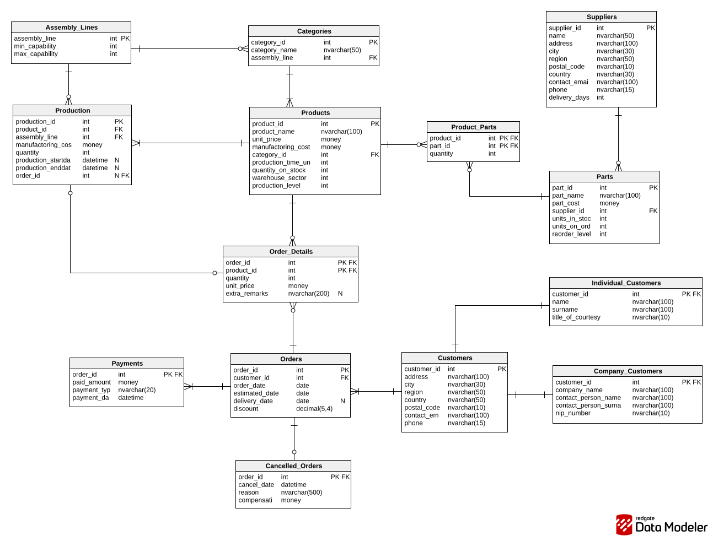

## Dokumentacja projektu "firma produkcyjno-usługowa"

Dzień i godzina zajęć: pt. 9:45

Nr zespołu: 18

**Autorzy:** Małgorzata Liskowska, Stanisław Ogonowski, Bartłomiej Wiśniewski

## 1. Wymagania funkcyjne systemu

Celem projektu jest projekt bazy danych dla firmy usługowo-produkcyjnej.
Klient biznesowy specjalizuje się w produkcji mebli biurowych, w szczególności do pomieszczeń z urządzeniami komputerowymi.

### Persona: klient sklepu

- klient składa zamówienie, znając oczekiwaną datę odbioru. Oczekiwana data reliazacji zamówienia jest obliczona automatycznie na podstawie aktualnych zamówień, stanu magazynu i dostępności części.
- w przypadku braku części potrzebnych do realizacji zamówienia, do oczekiwanej daty zamówienia dodawany jest także czas potrzebny na sprowadzenie części.
- klient może modyfikować swoje zamówienie, jednak może to powodować opóźnienie w planie produkcji.
- w przypadku rezygnacji z zamówienia klient może ponieść dodatkową opłatę.
- klient jest informowany w przypadku, gdy zamówienie jest opóźnione i może zrezygnować ze swojego zamówienia; wówczas nie ponosi dodatkowej opłaty za zamówienie.
- klient może zadeklarować metodę płatności jako karta/gotówka lub płatność przy odbiorze, a także regulować płatność na różne sposoby (np. zaliczka, lub w wielu ratach).
- klient może otrzymać rabat procentowy na całe zamówienie.
- klientem może być zarówno klient indywidualny jak i zewnętrzna firma.
- klient może przeglądać produkty po kategoriach.

### Założenia

- konkretna część jest dostarczana przez jednego dostawcę.
- koszt pracy linii produkcyjnych jest niezależny od liczby produktów.
- umowy z dostawcami są podpisywane z góry na cały rok.
- sklep nie odpowiada za wysyłkę towarów.
- produkty są składane na poszczególnych zespołach linii produkcyjnych, w zależności od kategorii, do której należą. Na danym zespole linii produkcyjnych mogą być produkowane produkty z wielu kategorii.
- zawarta jest informacja o maksymalnych mocach przerobowych firmy na konkretnym zestawie linii produkcyjnych.
- na każdym zestawie linii produkcyjnych istnieje minimalny poziom produkcji.
- sklep domawia części na magazyn, jeśli na magazynie jest mniej niż 10% docelowej wartości.
- w przypadku braku części na zamówienie sklep domawia je w taki sposób, aby wciąż osiągać określony cel.
- na podstawie aktualnych zamówień ustalana jest kolejka, na podstawie której produkowane są poszczególne produkty.
- w przypadku braku zamówień sklep dąży do określonego poziomu danego produktu na magazynie.
- klient może modyfikować swoje zamówienie:
  - w przypadku zmniejszenia wielkości zamówienia, wyprodukowana nadwyżka trafia na magazyn (Jeśli produkcja nie została rozpoczęta, jej plan jest odpowiednio modyfikowany).
  - w przypadku zwiększenia wielkości zamówienia:
    - Jeśli aktualna produkcja zwiększa się przed/w trakcie zamówienia, modyfikuje się plan produkcji dla danego produktu.
    - Jeśli aktualna produkcja zwiększa się po wyprodukowaniu zamówienia, tworzy się nowy plan produkcji dla dodatkowo zamówionej partii produktu.

## 2. Baza danych

## Schemat bazy danych



## Opisy poszczególnych tabel (wraz z kodem DDL)

### Products

| Kolumna         | Typ         | Klucz  | Opis/Uwagi                                            |
| --------------- | ----------- | ------ | ----------------------------------------------------- |
| product_id      | int         | główny | Identyfikator produktu                                |
| product_name    | nvarchar(100) |        | Nazwa produktu                                        |
| unit_price      | money         |    | Koszt wyprodukowania jednej sztuki (włącznie z częściami)  |
| manufactoring_cost      | money         |    | Koszt wyprodukowania jednej sztuki (robocizna)  
| category_id     | int         | obcy   | Identyfikator kategorii                               |
| production_time_unit | int         |        | Jednostka określająca całkowitą liczbę jednostek czasu, w której produkowany jest dany produkt. 10 jednostek to jedna roboczogodzina na taśmie produkcyjnej. |
| quantity_in_stock | int |              | Liczba sztuk na magazynie                                                            |
| warehouse_sector            | int |              | Sektor w magazynie, przy którym znajduje się produkt                                 |
| production_level  | int |              | Liczba sztuk produktu do której dąży się w przypadku mniejszych obrotów na produkcji |
| discontinued  | bit          |        | Określa, czy część została wycofana |


#### Kod DDL
```sql
-- Table: Assembly_Lines
CREATE TABLE Assembly_Lines (
    assembly_line int  NOT NULL IDENTITY,
    min_capability int  NOT NULL,
    max_capability int  NOT NULL,
    CONSTRAINT assembly_line CHECK (assembly_line >= 0),
    CONSTRAINT Power PRIMARY KEY  (assembly_line)
);
```

### ProductParts

| Kolumna    | Typ | Klucz        | Opis/Uwagi                                                                                           |
| ---------- | --- | ------------ | ---------------------------------------------------------------------------------------------------- |
| product_id | int | główny, obcy | Identyfikator produktu                                                                               |
| part_id    | int | główny, obcy | Identyfikator części potrzebnej do produkcji produktu o identyfikatorze product_id                   |
| quantity   | int |              | Liczba części o identyfikatorze part_id potrzebna do produkcji produktu o identyfikatorze product_id |

#### Kod DDL
```sql
-- Table: Assembly_Lines
CREATE TABLE Assembly_Lines (
    assembly_line int  NOT NULL IDENTITY,
    min_capability int  NOT NULL,
    max_capability int  NOT NULL,
    CONSTRAINT assembly_line CHECK (assembly_line >= 0),
    CONSTRAINT Power PRIMARY KEY  (assembly_line)
);
```

### Parts

| Kolumna        | Typ          | Klucz  | Opis/Uwagi                                              |
| -------------- | ------------ | ------ | ------------------------------------------------------- |
| part_id        | int          | główny | Identyfikator części                                    |
| part_name      | nvarchar(100) |        | Nazwa części                                            |
| part_cost      | money        |        | Cena jednostkowa części                                 |
| supplier_id    | int          | obcy   | Identyfikator dostawcy                                  |
| units_in_stock | int          |        | Liczba części w magazynie                               |
| units_on_order | int          |        | Liczba części zamówionych (w drodze)                    |
| reorder_level  | int          |        | Liczba units_in_stock przy której należy domówić części |
| discontinued  | bit          |        | Określa, czy część została wycofana |

#### Kod DDL
```sql
-- Table: Assembly_Lines
CREATE TABLE Assembly_Lines (
    assembly_line int  NOT NULL IDENTITY,
    min_capability int  NOT NULL,
    max_capability int  NOT NULL,
    CONSTRAINT assembly_line CHECK (assembly_line >= 0),
    CONSTRAINT Power PRIMARY KEY  (assembly_line)
);
```

### Suppliers

| Kolumna       | Typ          | Klucz  | Opis/Uwagi                                                                  |
| ------------- | ------------ | ------ | --------------------------------------------------------------------------- |
| supplier_id   | int          | główny | Identyfikator dostawcy                                                      |
| name          | nvarchar(50)  |        | Nazwa firmy dostarczającej części                                           |
| adress        | nvarchar(100) |        | Ulica i numer budynku                                                       |
| city          | nvarchar(30) |        | Miasto siedziby firmy                                                       |
| region        | nvarchar(50) |        | Województwo/stan/land                                                       |
| postal_code   | nvarchar (10)      |        | Kod pocztowy                                                                |
| country       | nvarchar(30)  |        | Kraj                                                                        |
| contact_email | nvarchar(100) |        | Adres email                                                |
| phone         | nvarchar (15)       |        | Numer telefonu                                       |
| delivery_days | int          |        | Średni oczekiwany czas dostawy (do oszacowania czasu realizacji zamówienia) |

#### Kod DDL
```sql
-- Table: Assembly_Lines
CREATE TABLE Assembly_Lines (
    assembly_line int  NOT NULL IDENTITY,
    min_capability int  NOT NULL,
    max_capability int  NOT NULL,
    CONSTRAINT assembly_line CHECK (assembly_line >= 0),
    CONSTRAINT Power PRIMARY KEY  (assembly_line)
);
```

### Categories

| Kolumna       | Typ         | Klucz  | Opis/Uwagi               |
| ------------- | ----------- | ------ | ------------------------ |
| category_id   | int         | główny | Identyfikator kategorii  |
| category_name | nvarchar(50)|        | Nazwa kategorii          |
| assembly_line | int         | obcy   | Numer zespołu linii produkcyjnych |

#### Kod DDL
```sql
-- Table: Assembly_Lines
CREATE TABLE Assembly_Lines (
    assembly_line int  NOT NULL IDENTITY,
    min_capability int  NOT NULL,
    max_capability int  NOT NULL,
    CONSTRAINT assembly_line CHECK (assembly_line >= 0),
    CONSTRAINT Power PRIMARY KEY  (assembly_line)
);
```

### AssemblyLines

| Kolumna        | Typ | Klucz  | Opis/Uwagi                                                      |
| -------------- | --- | ------ | --------------------------------------------------------------- |
| assembly_line  | int | główny | Numer taśmy produkcyjnej                                        |
| min_capability | int |        | Minimalna liczba produktów wytwarzanych na taśmie w ciągu dnia  |
| max_capability | int |        | Maksymalna liczba produktów wytwarzanych na taśmie w ciągu dnia |

#### Kod DDL
```sql
-- Table: Assembly_Lines
CREATE TABLE Assembly_Lines (
    assembly_line int  NOT NULL IDENTITY,
    min_capability int  NOT NULL,
    max_capability int  NOT NULL,
    CONSTRAINT assembly_line CHECK (assembly_line >= 0),
    CONSTRAINT Power PRIMARY KEY  (assembly_line)
);
```

### Production

| Kolumna              | Typ      | Klucz        | Opis/Uwagi                                     |
| -------------------- | -------- | ------------ | ---------------------------------------------- |
| production_id           | int      | główny | Identyfikator produkcji  
| product_id           | int      | główny, obcy | Identyfikator produktu                         |
| assembly_line        | int      | główny, obcy | Numer taśmy produkcyjnej                       |                       |
| manufactoring_cost      | money         |    | Koszt wyprodukowania jednej sztuki (włącznie z częściami - koszt ten może się zmieniać z biegiem czasu)  
| quantity             | int      |              | Liczba wyprodukowanego produktu w danej partii |
| production_startdate | datetime |              | Data rozpoczęcia produkcji                                |
| production_enddate   | datetime |              | Data zakończenia produkcji                               |

#### Kod DDL
```sql
-- Table: Assembly_Lines
CREATE TABLE Assembly_Lines (
    assembly_line int  NOT NULL IDENTITY,
    min_capability int  NOT NULL,
    max_capability int  NOT NULL,
    CONSTRAINT assembly_line CHECK (assembly_line >= 0),
    CONSTRAINT Power PRIMARY KEY  (assembly_line)
);
```

### Orders

| Kolumna       | Typ           | Klucz  | Opis/Uwagi                                 |
| ------------- | ------------- | ------ | ------------------------------------------ |
| order_id      | int           | główny | Identyfikator zamówienia                   |
| customer_id   | int           | obcy   | Identyfikator klienta                      |
| order_date    | date          |        | Data złożenia zamówienia                   |
| estimated_date | date          |        | Zadeklarowana data dostarczenia zamówienia |
| delivery_date | date          |        | Rzeczywista data dostarczenia zamówienia   |
| discount      | decimal(5,4) |        | Zniżka na całe zamówienie                  ||
| order_status      | nvarchar(5) |        | Aktualny status zamówienia                 ||

#### Kod DDL
```sql
-- Table: Assembly_Lines
CREATE TABLE Assembly_Lines (
    assembly_line int  NOT NULL IDENTITY,
    min_capability int  NOT NULL,
    max_capability int  NOT NULL,
    CONSTRAINT assembly_line CHECK (assembly_line >= 0),
    CONSTRAINT Power PRIMARY KEY  (assembly_line)
);
```

### OrderDetails

| Kolumna            | Typ          | Klucz        | Opis/Uwagi                         |
| ------------------ | ------------ | ------------ | ---------------------------------- |
| order_id           | int          | główny, obcy | Identyfikator zamówienia           |
| product_id         | int          | główny, obcy | Identyfikator produktu             |
| quantity           | int          |              | Liczba zamówionych sztuk           |
| unit_price         | money        |              | Cena za sztukę     |                |
| extra_remarks      | nvarchar(200) |              | Uwagi dodatkowe                    |

#### Kod DDL
```sql
-- Table: Assembly_Lines
CREATE TABLE Assembly_Lines (
    assembly_line int  NOT NULL IDENTITY,
    min_capability int  NOT NULL,
    max_capability int  NOT NULL,
    CONSTRAINT assembly_line CHECK (assembly_line >= 0),
    CONSTRAINT Power PRIMARY KEY  (assembly_line)
);
```

### Payments

| Kolumna           | Typ         | Klucz        | Opis/Uwagi            |
| ----------------- | ----------- | ------------ | --------------------- |
| order_id       | int         | główny, obcy | Identyfikator zamówienia |
| paid_amount              | money |              | Zapłacona kwota          |
| payment_type           | nvarchar(20) |              | Typ płatności (np. karta przy odbiorze, BLIK, przelew)      |
| payment_date | datetime |              | Data zaksięgowania przelewu              |

#### Kod DDL
```sql
-- Table: Assembly_Lines
CREATE TABLE Assembly_Lines (
    assembly_line int  NOT NULL IDENTITY,
    min_capability int  NOT NULL,
    max_capability int  NOT NULL,
    CONSTRAINT assembly_line CHECK (assembly_line >= 0),
    CONSTRAINT Power PRIMARY KEY  (assembly_line)
);
```

### Cancelled_Orders

| Kolumna           | Typ         | Klucz        | Opis/Uwagi            |
| ----------------- | ----------- | ------------ | --------------------- |
| order_id       | int         | główny, obcy | Identyfikator zamówienia |
| cancel_date              | datetime |              | Data anulowania zamówienia          |
| reason           | nvarchar(500) |              | Powód anulowania zamówienia      |
| compensation | money |              | Wartość dodatkowej opłaty za anulowane zamówienie              |

#### Kod DDL
```sql
-- Table: Assembly_Lines
CREATE TABLE Assembly_Lines (
    assembly_line int  NOT NULL IDENTITY,
    min_capability int  NOT NULL,
    max_capability int  NOT NULL,
    CONSTRAINT assembly_line CHECK (assembly_line >= 0),
    CONSTRAINT Power PRIMARY KEY  (assembly_line)
);
```

### Customers

| Kolumna       | Typ          | Klucz  | Opis/Uwagi                                           |
| ------------- | -------------- | ------ | ---------------------------------------------------- |
| customer_id   | int          | główny | Identyfikator klienta                                |
| address        | nvarchar (100)    |        | Ulica i numer budynku                                |
| city          | nvarchar(30) |        | Miasto siedziby klienta/ Miasto zamieszkania klienta |
| region        | nvarchar(50) |        | Województwo/stan/land                                |
| country       | nvarchar(50)  |        | Kraj                                                 |
| postal_code   | nvarchar(10)       |        | Kod pocztowy                                         |
| contact_email | nvarchar(100) |        | Email                                                |
| phone         | nvarchar (15)       |        | Numer telefonu                                       |

#### Kod DDL
```sql
-- Table: Assembly_Lines
CREATE TABLE Assembly_Lines (
    assembly_line int  NOT NULL IDENTITY,
    min_capability int  NOT NULL,
    max_capability int  NOT NULL,
    CONSTRAINT assembly_line CHECK (assembly_line >= 0),
    CONSTRAINT Power PRIMARY KEY  (assembly_line)
);
```

### IndividualCustomer

| Kolumna           | Typ         | Klucz        | Opis/Uwagi            |
| ----------------- | ----------- | ------------ | --------------------- |
| customer_id       | int         | główny, obcy | Identyfikator klienta |
| name              | nvarchar(100) |              | Imię klienta          |
| surname           | nvarchar(100) |              | Nazwisko klienta      |
| title_of_courtesy | nvarchar(10) |              | Pan/Pani              |

#### Kod DDL
```sql
-- Table: Assembly_Lines
CREATE TABLE Assembly_Lines (
    assembly_line int  NOT NULL IDENTITY,
    min_capability int  NOT NULL,
    max_capability int  NOT NULL,
    CONSTRAINT assembly_line CHECK (assembly_line >= 0),
    CONSTRAINT Power PRIMARY KEY  (assembly_line)
);
```

### CompanyCustomer

| Kolumna                | Typ          | Klucz        | Opis/Uwagi                 |
| ---------------------- | ------------ | ------------ | -------------------------- |
| customer_id            | int          | główny, obcy | Identyfikator klienta      |
| company_name           | nvarchar(100)  |              | Nazwa firmy                |
| contact_person_name    | nvarchar(100) |              | Imię osoby kontaktowej     |
| contact_person_surname | nvarchar(100) |              | Nazwisko osoby kontaktowej |
| nip_number             | nvarchar (10)          |              | Numer NIP firmy            |

#### Kod DDL
```sql
-- Table: Assembly_Lines
CREATE TABLE Assembly_Lines (
    assembly_line int  NOT NULL IDENTITY,
    min_capability int  NOT NULL,
    max_capability int  NOT NULL,
    CONSTRAINT assembly_line CHECK (assembly_line >= 0),
    CONSTRAINT Power PRIMARY KEY  (assembly_line)
);
```

### Days_Off

| Kolumna                | Typ          | Klucz        | Opis/Uwagi                 |
| ---------------------- | ------------ | ------------ | -------------------------- |
| holiday_date            | date          | główny | Data święta wolnego od pracy      |
| holiday_name           | date  |              | Nazwa święta wolnego od pracy               |

#### Kod DDL
```sql
-- Table: Assembly_Lines
CREATE TABLE Assembly_Lines (
    assembly_line int  NOT NULL IDENTITY,
    min_capability int  NOT NULL,
    max_capability int  NOT NULL,
    CONSTRAINT assembly_line CHECK (assembly_line >= 0),
    CONSTRAINT Power PRIMARY KEY  (assembly_line)
);
```

## Referencje pomiędzy tabelami

```sql
-- Table: Assembly_Lines
CREATE TABLE Assembly_Lines (
    assembly_line int  NOT NULL IDENTITY,
    min_capability int  NOT NULL,
    max_capability int  NOT NULL,
    CONSTRAINT assembly_line CHECK (assembly_line >= 0),
    CONSTRAINT Power PRIMARY KEY  (assembly_line)
);

-- Table: Cancelled_Orders
CREATE TABLE Cancelled_Orders (
    order_id int  NOT NULL,
    cancel_date datetime  NOT NULL,
    reason nvarchar(500)  NOT NULL,
    compensation money  NOT NULL CHECK (compensation >= 0),
    CONSTRAINT Cancelled_Orders_pk PRIMARY KEY  (order_id)
);

-- Table: Categories
CREATE TABLE Categories (
    category_id int  NOT NULL IDENTITY,
    category_name nvarchar(50)  NOT NULL,
    assembly_line int  NOT NULL,
    CONSTRAINT Categories_pk PRIMARY KEY  (category_id)
);

-- Table: Company_Customers
CREATE TABLE Company_Customers (
    customer_id int  NOT NULL,
    company_name nvarchar(100)  NOT NULL,
    contact_person_name nvarchar(100)  NOT NULL,
    contact_person_surname nvarchar(100)  NOT NULL,
    nip_number nvarchar(10)  NOT NULL,
    CONSTRAINT Company_Customers_pk PRIMARY KEY  (customer_id)
);

-- Table: Customers
CREATE TABLE Customers (
    customer_id int  NOT NULL IDENTITY,
    address nvarchar(100)  NOT NULL,
    city nvarchar(30)  NOT NULL,
    region nvarchar(50)  NOT NULL,
    country nvarchar(50)  NOT NULL,
    postal_code nvarchar(10)  NOT NULL,
    contact_email nvarchar(100)  NOT NULL CHECK (contact_email LIKE '%_@__%.__%'),
    phone nvarchar(15)  NOT NULL,
    CONSTRAINT Customers_pk PRIMARY KEY  (customer_id)
);

-- Table: Individual_Customers
CREATE TABLE Individual_Customers (
    customer_id int  NOT NULL,
    name nvarchar(100)  NOT NULL,
    surname nvarchar(100)  NOT NULL,
    title_of_courtesy nvarchar(10)  NOT NULL,
    CONSTRAINT Individual_Customers_pk PRIMARY KEY  (customer_id)
);

-- Table: Order_Details
CREATE TABLE Order_Details (
    order_id int  NOT NULL,
    product_id int  NOT NULL,
    quantity int  NOT NULL CHECK (quantity > 0),
    unit_price money  NOT NULL CHECK (unit_price > 0),
    extra_remarks nvarchar(200)  NULL,
    CONSTRAINT Order_Details_pk PRIMARY KEY  (order_id,product_id)
);

-- Table: Orders
CREATE TABLE Orders (
    order_id int  NOT NULL IDENTITY,
    customer_id int  NOT NULL,
    order_date date  NOT NULL,
    required_date date  NOT NULL,
    delivery_date date  NULL,
    discount decimal(5,4)  NOT NULL CHECK (discount BETWEEN 0 AND 1 ),
    CONSTRAINT required_date_after_order CHECK (required_date >= order_date),
    CONSTRAINT delivery_date_after_order CHECK (delivery_date >= order_date),
    CONSTRAINT Orders_pk PRIMARY KEY  (order_id)
);

-- Table: Parts
CREATE TABLE Parts (
    part_id int  NOT NULL IDENTITY,
    part_name nvarchar(100)  NOT NULL,
    part_cost money  NOT NULL CHECK (part_cost >= 0),
    supplier_id int  NOT NULL,
    units_in_stock int  NOT NULL CHECK (units_in_stock >= 0),
    units_on_order int  NOT NULL CHECK (units_on_order >= 0),
    reorder_level int  NOT NULL CHECK (reorder_level >= 0),
    CONSTRAINT Parts_pk PRIMARY KEY  (part_id)
);

-- Table: Payments
CREATE TABLE Payments (
    order_id int  NOT NULL,
    paid_amount money  NOT NULL CHECK (paid_amount > 0),
    payment_type nvarchar(20)  NOT NULL,
    payment_date datetime  NOT NULL,
    CONSTRAINT Payments_pk PRIMARY KEY  (order_id)
);

-- Table: Product_Parts
CREATE TABLE Product_Parts (
    product_id int  NOT NULL,
    part_id int  NOT NULL,
    quantity int  NOT NULL CHECK (quantity >= 0),
    CONSTRAINT Product_Parts_pk PRIMARY KEY  (part_id,product_id)
);

-- Table: Production
CREATE TABLE Production (
    production_id int  NOT NULL IDENTITY,
    product_id int  NOT NULL,
    assembly_line int  NOT NULL,
    manufacturing_cost money  NOT NULL CHECK (manufacturing_cost >= 0),
    quantity int  NOT NULL CHECK (quantity >= 0),
    production_startdate datetime  NULL,
    production_enddate datetime  NULL,
    order_id int  NULL,
    CONSTRAINT production_startdate_bef_enddate CHECK (production_startdate <= production_enddate),
    CONSTRAINT Production_pk PRIMARY KEY  (production_id)
);

-- Table: Products
CREATE TABLE Products (
    product_id int  NOT NULL IDENTITY,
    product_name nvarchar(100)  NOT NULL,
    manufacturing_cost money  NOT NULL CHECK (manufacturing_cost >= 0),
    category_id int  NOT NULL,
    production_time_unit int  NOT NULL CHECK (production_time_unit >= 0),
    quantity_on_stock int  NOT NULL CHECK (quantity_on_stock >= 0),
    warehouse_sector int  NOT NULL CHECK (warehouse_sector >=0),
    production_level int  NOT NULL CHECK (production_level >= 0),
    CONSTRAINT ProductId PRIMARY KEY  (product_id)
);
-- Table: Suppliers
CREATE TABLE Suppliers (
    supplier_id int  NOT NULL IDENTITY,
    name nvarchar(50)  NOT NULL,
    address nvarchar(100)  NOT NULL,
    city nvarchar(30)  NOT NULL,
    region nvarchar(50)  NOT NULL,
    postal_code nvarchar(10)  NOT NULL,
    country nvarchar(30)  NOT NULL,
    contact_email nvarchar(100)  NOT NULL CHECK (contact_email LIKE '%_@__%.__%'),
    phone nvarchar(15)  NOT NULL,
    delivery_days int  NOT NULL CHECK (delivery_days >= 0),
    CONSTRAINT Suppliers_pk PRIMARY KEY  (supplier_id)
);

-- foreign keys
-- Reference: AssemblyLines_Category (table: Categories)
ALTER TABLE Categories ADD CONSTRAINT AssemblyLines_Category
    FOREIGN KEY (assembly_line)
    REFERENCES Assembly_Lines (assembly_line);

-- Reference: CompanyCustomer_Customers (table: Company_Customers)
ALTER TABLE Company_Customers ADD CONSTRAINT CompanyCustomer_Customers
    FOREIGN KEY (customer_id)
    REFERENCES Customers (customer_id);

-- Reference: Customers_Orders (table: Orders)
ALTER TABLE Orders ADD CONSTRAINT Customers_Orders
    FOREIGN KEY (customer_id)
    REFERENCES Customers (customer_id);

-- Reference: IndividualCustomer_Customers (table: Individual_Customers)
ALTER TABLE Individual_Customers ADD CONSTRAINT IndividualCustomer_Customers
    FOREIGN KEY (customer_id)
    REFERENCES Customers (customer_id);

-- Reference: OrderDetails_Production (table: Production)
ALTER TABLE Production ADD CONSTRAINT OrderDetails_Production
    FOREIGN KEY (order_id,product_id)
    REFERENCES Order_Details (order_id,product_id);

-- Reference: Order_Details_Product (table: Order_Details)
ALTER TABLE Order_Details ADD CONSTRAINT Order_Details_Product
    FOREIGN KEY (product_id)
    REFERENCES Products (product_id);

-- Reference: Order_Order_Details (table: Order_Details)
ALTER TABLE Order_Details ADD CONSTRAINT Order_Order_Details
    FOREIGN KEY (order_id)
    REFERENCES Orders (order_id);

-- Reference: Orders_Cancelled_Orders (table: Cancelled_Orders)
ALTER TABLE Cancelled_Orders ADD CONSTRAINT Orders_Cancelled_Orders
    FOREIGN KEY (order_id)
    REFERENCES Orders (order_id);

-- Reference: Orders_Payment (table: Payments)
ALTER TABLE Payments ADD CONSTRAINT Orders_Payment
    FOREIGN KEY (order_id)
    REFERENCES Orders (order_id);

-- Reference: Part_Supplier (table: Parts)
ALTER TABLE Parts ADD CONSTRAINT Part_Supplier
    FOREIGN KEY (supplier_id)
    REFERENCES Suppliers (supplier_id);

-- Reference: ProductPart_Part (table: Product_Parts)
ALTER TABLE Product_Parts ADD CONSTRAINT ProductPart_Part
    FOREIGN KEY (part_id)
    REFERENCES Parts (part_id);

-- Reference: ProductPart_Product (table: Product_Parts)
ALTER TABLE Product_Parts ADD CONSTRAINT ProductPart_Product
    FOREIGN KEY (product_id)
    REFERENCES Products (product_id);

-- Reference: Product_Category (table: Products)
ALTER TABLE Products ADD CONSTRAINT Product_Category
    FOREIGN KEY (category_id)
    REFERENCES Categories (category_id);

-- Reference: Production_AssemblyLines (table: Production)
ALTER TABLE Production ADD CONSTRAINT Production_AssemblyLines
    FOREIGN KEY (assembly_line)
    REFERENCES Assembly_Lines (assembly_line);

-- Reference: Production_Product (table: Production)
ALTER TABLE Production ADD CONSTRAINT Production_Product
    FOREIGN KEY (product_id)
    REFERENCES Products (product_id);

```

- Opis: (opis tabeli, komentarz)
- np.

| Nazwa atrybutu | Typ | Opis/Uwagi |
| -------------- | --- | ---------- |
| Atrybut 1 …    |     |            |
| Atrybut 2 …    |     |            |

# 3. Widoki, procedury/funkcje, triggery

## Widoki

(dla każdego widoku należy wkleić kod polecenia definiującego widok wraz z komentarzem)

```sql
crete or alter view vw_abc
as
select a from tab1
```

## Procedury/funkcje

(dla każdej procedury/funkcji należy wkleić kod polecenia definiującego procedurę wraz z komentarzem)

```sql
-- ...
```

## Triggery

(dla każdego triggera należy wkleić kod polecenia definiującego trigger wraz z komentarzem)

```sql
-- ...
```

# 4. Inne

(informacja o sposobie wygenerowania danych, uprawnienia …)
