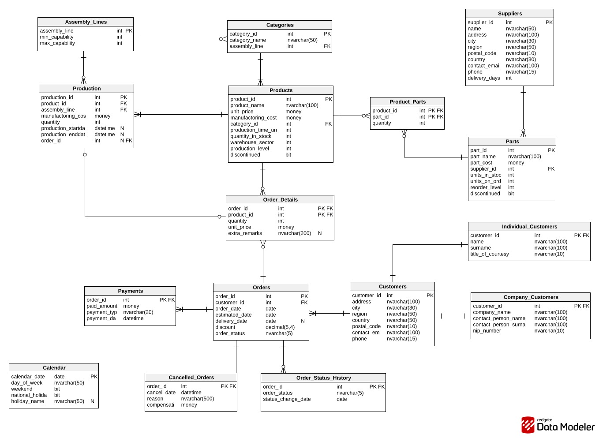

## Dokumentacja projektu "firma produkcyjno-usługowa"

Dzień i godzina zajęć: pt. 9:45

Nr zespołu: 18

**Autorzy:** Małgorzata Liskowska, Stanisław Ogonowski, Bartłomiej Wiśniewski

## 1. Wymagania funkcyjne systemu

Celem projektu jest projekt bazy danych dla firmy usługowo-produkcyjnej.
Klient biznesowy specjalizuje się w produkcji mebli biurowych, w szczególności do pomieszczeń z urządzeniami komputerowymi.

### Persona: klient sklepu

- klient składa zamówienie, znając oczekiwaną datę odbioru. Oczekiwana data reliazacji zamówienia jest obliczona automatycznie na podstawie aktualnych zamówień, stanu magazynu i dostępności części.
- w przypadku braku części potrzebnych do realizacji zamówienia, do oczekiwanej daty zamówienia dodawany jest także czas potrzebny na sprowadzenie części.
- klient może modyfikować swoje zamówienie, jednak może to powodować opóźnienie w planie produkcji.
- w przypadku rezygnacji z zamówienia klient może ponieść dodatkową opłatę.
- klient jest informowany w przypadku, gdy zamówienie jest opóźnione i może zrezygnować ze swojego zamówienia; wówczas nie ponosi dodatkowej opłaty za zamówienie.
- klient może zadeklarować metodę płatności jako karta/gotówka lub płatność przy odbiorze, a także regulować płatność na różne sposoby (np. zaliczka, lub w wielu ratach).
- klient może otrzymać rabat procentowy na całe zamówienie.
- klientem może być zarówno klient indywidualny jak i zewnętrzna firma.
- klient może przeglądać produkty po kategoriach.

### Założenia

- konkretna część jest dostarczana przez jednego dostawcę.
- koszt pracy linii produkcyjnych jest niezależny od liczby produktów.
- umowy z dostawcami są podpisywane z góry na cały rok.
- sklep nie odpowiada za wysyłkę towarów.
- produkty są składane na poszczególnych zespołach linii produkcyjnych, w zależności od kategorii, do której należą. Na danym zespole linii produkcyjnych mogą być produkowane produkty z wielu kategorii.
- zawarta jest informacja o maksymalnych mocach przerobowych firmy na konkretnym zestawie linii produkcyjnych.
- na każdym zestawie linii produkcyjnych istnieje minimalny poziom produkcji.
- sklep domawia części na magazyn, jeśli na magazynie jest mniej niż 10% docelowej wartości.
- w przypadku braku części na zamówienie sklep domawia je w taki sposób, aby wciąż osiągać określony cel.
- na podstawie aktualnych zamówień ustalana jest kolejka, na podstawie której produkowane są poszczególne produkty.
- w przypadku braku zamówień sklep dąży do określonego poziomu danego produktu na magazynie.
- klient może modyfikować swoje zamówienie:
  - w przypadku zmniejszenia wielkości zamówienia, wyprodukowana nadwyżka trafia na magazyn (Jeśli produkcja nie została rozpoczęta, jej plan jest odpowiednio modyfikowany).
  - w przypadku zwiększenia wielkości zamówienia:
    - Jeśli aktualna produkcja zwiększa się przed/w trakcie zamówienia, modyfikuje się plan produkcji dla danego produktu.
    - Jeśli aktualna produkcja zwiększa się po wyprodukowaniu zamówienia, tworzy się nowy plan produkcji dla dodatkowo zamówionej partii produktu.

## 2. Baza danych

## Schemat bazy danych



## Opisy poszczególnych tabel (wraz z kodem DDL)

### Products

| Kolumna              | Typ           | Klucz  | Opis/Uwagi                                                                                                                                                   |
| -------------------- | ------------- | ------ | ------------------------------------------------------------------------------------------------------------------------------------------------------------ |
| product_id           | int           | główny | Identyfikator produktu                                                                                                                                       |
| product_name         | nvarchar(100) |        | Nazwa produktu                                                                                                                                               |
| unit_price           | money         |        | Koszt wyprodukowania jednej sztuki (włącznie z częściami)                                                                                                    |
| manufactoring_cost   | money         |        | Koszt wyprodukowania jednej sztuki (robocizna)                                                                                                               |
| category_id          | int           | obcy   | Identyfikator kategorii                                                                                                                                      |
| production_time_unit | int           |        | Jednostka określająca całkowitą liczbę jednostek czasu, w której produkowany jest dany produkt. 10 jednostek to jedna roboczogodzina na taśmie produkcyjnej. |
| quantity_in_stock    | int           |        | Liczba sztuk na magazynie                                                                                                                                    |
| warehouse_sector     | int           |        | Sektor w magazynie, przy którym znajduje się produkt                                                                                                         |
| production_level     | int           |        | Liczba sztuk produktu do której dąży się w przypadku mniejszych obrotów na produkcji                                                                         |
| discontinued         | bit           |        | Określa, czy część została wycofana                                                                                                                          |

#### Kod DDL

```sql
-- Table: Products
CREATE TABLE Products (
    product_id int  NOT NULL IDENTITY,
    product_name nvarchar(100)  NOT NULL,
    manufacturing_cost money  NOT NULL CHECK (manufacturing_cost >= 0),
    unit_price money NOT NULL CHECK (unit_price >= 0),
    category_id int  NOT NULL,
    production_time_unit int  NOT NULL CHECK (production_time_unit >= 0),
    quantity_on_stock int  NOT NULL CHECK (quantity_on_stock >= 0),
    warehouse_sector int  NOT NULL CHECK (warehouse_sector >=0),
    production_level int  NOT NULL CHECK (production_level >= 0),
    CONSTRAINT Products_pk PRIMARY KEY  (product_id)
);
```

### ProductParts

| Kolumna    | Typ | Klucz        | Opis/Uwagi                                                                                           |
| ---------- | --- | ------------ | ---------------------------------------------------------------------------------------------------- |
| product_id | int | główny, obcy | Identyfikator produktu                                                                               |
| part_id    | int | główny, obcy | Identyfikator części potrzebnej do produkcji produktu o identyfikatorze product_id                   |
| quantity   | int |              | Liczba części o identyfikatorze part_id potrzebna do produkcji produktu o identyfikatorze product_id |

#### Kod DDL

```sql
-- Table: Product_Parts
CREATE TABLE Product_Parts (
    product_id int  NOT NULL,
    part_id int  NOT NULL,
    quantity int  NOT NULL CHECK (quantity >= 0),
    CONSTRAINT Product_Parts_pk PRIMARY KEY  (part_id,product_id)
);
```

### Parts

| Kolumna        | Typ           | Klucz  | Opis/Uwagi                                              |
| -------------- | ------------- | ------ | ------------------------------------------------------- |
| part_id        | int           | główny | Identyfikator części                                    |
| part_name      | nvarchar(100) |        | Nazwa części                                            |
| part_cost      | money         |        | Cena jednostkowa części                                 |
| supplier_id    | int           | obcy   | Identyfikator dostawcy                                  |
| units_in_stock | int           |        | Liczba części w magazynie                               |
| units_on_order | int           |        | Liczba części zamówionych (w drodze)                    |
| reorder_level  | int           |        | Liczba units_in_stock przy której należy domówić części |
| discontinued   | bit           |        | Określa, czy część została wycofana                     |

#### Kod DDL

```sql
-- Table: Parts
CREATE TABLE Parts (
    part_id int  NOT NULL IDENTITY,
    part_name nvarchar(100)  NOT NULL,
    part_cost money  NOT NULL CHECK (part_cost >= 0),
    supplier_id int  NOT NULL,
    units_in_stock int  NOT NULL CHECK (units_in_stock >= 0),
    units_on_order int  NOT NULL CHECK (units_on_order >= 0),
    reorder_level int  NOT NULL CHECK (reorder_level >= 0),
    CONSTRAINT Parts_pk PRIMARY KEY  (part_id)
);
```

### Suppliers

| Kolumna       | Typ           | Klucz  | Opis/Uwagi                                                                  |
| ------------- | ------------- | ------ | --------------------------------------------------------------------------- |
| supplier_id   | int           | główny | Identyfikator dostawcy                                                      |
| name          | nvarchar(50)  |        | Nazwa firmy dostarczającej części                                           |
| adress        | nvarchar(100) |        | Ulica i numer budynku                                                       |
| city          | nvarchar(30)  |        | Miasto siedziby firmy                                                       |
| region        | nvarchar(50)  |        | Województwo/stan/land                                                       |
| postal_code   | nvarchar (10) |        | Kod pocztowy                                                                |
| country       | nvarchar(30)  |        | Kraj                                                                        |
| contact_email | nvarchar(100) |        | Adres email                                                                 |
| phone         | nvarchar (15) |        | Numer telefonu                                                              |
| delivery_days | int           |        | Średni oczekiwany czas dostawy (do oszacowania czasu realizacji zamówienia) |

#### Kod DDL

```sql
-- Table: Suppliers
CREATE TABLE Suppliers (
    supplier_id int  NOT NULL IDENTITY,
    name nvarchar(50)  NOT NULL,
    address nvarchar(100)  NOT NULL,
    city nvarchar(30)  NOT NULL,
    region nvarchar(50)  NOT NULL,
    postal_code nvarchar(10)  NOT NULL,
    country nvarchar(30)  NOT NULL,
    contact_email nvarchar(100)  NOT NULL CHECK (contact_email LIKE '%_@__%.__%'),
    phone nvarchar(15)  NOT NULL,
    delivery_days int  NOT NULL CHECK (delivery_days >= 0),
    CONSTRAINT Suppliers_pk PRIMARY KEY  (supplier_id)
);
```

### Categories

| Kolumna       | Typ          | Klucz  | Opis/Uwagi                        |
| ------------- | ------------ | ------ | --------------------------------- |
| category_id   | int          | główny | Identyfikator kategorii           |
| category_name | nvarchar(50) |        | Nazwa kategorii                   |
| assembly_line | int          | obcy   | Numer zespołu linii produkcyjnych |

#### Kod DDL

```sql
-- Table: Categories
CREATE TABLE Categories (
    category_id int  NOT NULL IDENTITY,
    category_name nvarchar(50)  NOT NULL,
    assembly_line int  NOT NULL,
    CONSTRAINT Categories_pk PRIMARY KEY  (category_id)
);
```

### AssemblyLines

| Kolumna        | Typ | Klucz  | Opis/Uwagi                                                      |
| -------------- | --- | ------ | --------------------------------------------------------------- |
| assembly_line  | int | główny | Numer taśmy produkcyjnej                                        |
| min_capability | int |        | Minimalna liczba produktów wytwarzanych na taśmie w ciągu dnia  |
| max_capability | int |        | Maksymalna liczba produktów wytwarzanych na taśmie w ciągu dnia |

#### Kod DDL

```sql
-- Table: Assembly_Lines
CREATE TABLE Assembly_Lines (
    assembly_line int  NOT NULL IDENTITY CHECK (assembly_line >= 0),
    min_capability int  NOT NULL,
    max_capability int  NOT NULL,
    CONSTRAINT Assembly_Lines_pk PRIMARY KEY  (assembly_line)
);
```

### Production

| Kolumna              | Typ      | Klucz        | Opis/Uwagi |                                                                                             |
| -------------------- | -------- | ------------ | ------------------------------------------------------------------------------------------------------- | --- |
| production_id        | int      | główny       | Identyfikator produkcji                                                                                 |
| product_id           | int      | główny, obcy | Identyfikator produktu                                                                                  |
| assembly_line        | int      | główny, obcy | Numer taśmy produkcyjnej                                                                                |     |
| manufactoring_cost   | money    |              | Koszt wyprodukowania jednej sztuki (włącznie z częściami - koszt ten może się zmieniać z biegiem czasu) |
| quantity             | int      |              | Liczba wyprodukowanego produktu w danej partii                                                          |
| production_startdate | datetime |              | Data rozpoczęcia produkcji                                                                              |
| production_enddate   | datetime |              | Data zakończenia produkcji                                                                              |

#### Kod DDL

```sql
-- Table: Production
CREATE TABLE Production (
    production_id int  NOT NULL IDENTITY,
    product_id int  NOT NULL,
    assembly_line int  NOT NULL,
    manufacturing_cost money  NOT NULL CHECK (manufacturing_cost >= 0),
    quantity int  NOT NULL CHECK (quantity >= 0),
    production_startdate datetime  NULL,
    production_enddate datetime  NULL,
    order_id int  NULL,
    CONSTRAINT production_startdate_bef_enddate CHECK (production_startdate <= production_enddate),
    CONSTRAINT Production_pk PRIMARY KEY  (production_id)
);
```

### Orders

| Kolumna        | Typ          | Klucz  | Opis/Uwagi                                 ||
| -------------- | ------------ | ------ | ------------------------------------------ | --- |
| order_id       | int          | główny | Identyfikator zamówienia                   |
| customer_id    | int          | obcy   | Identyfikator klienta                      |
| order_date     | date         |        | Data złożenia zamówienia                   |
| estimated_date | date         |        | Zadeklarowana data dostarczenia zamówienia |
| delivery_date  | date         |        | Rzeczywista data dostarczenia zamówienia   |
| discount       | decimal(5,4) |        | Zniżka na całe zamówienie                  |     |
| order_status   | nvarchar(5)  |        | Aktualny status zamówienia                 |     |

#### Kod DDL

```sql
-- Table: Orders
CREATE TABLE Orders (
    order_id int  NOT NULL IDENTITY,
    customer_id int  NOT NULL,
    order_date date  NOT NULL,
    estimated_date date,
    delivery_date date  NULL,
    discount decimal(5,4)  NOT NULL CHECK (discount BETWEEN 0 AND 1 ),
    CONSTRAINT required_date_after_order CHECK (estimated_date >= order_date),
    CONSTRAINT delivery_date_after_order CHECK (delivery_date >= order_date),
    CONSTRAINT Orders_pk PRIMARY KEY  (order_id)
);
```

### OrderDetails

| Kolumna       | Typ           | Klucz        | Opis/Uwagi               ||
| ------------- | ------------- | ------------ | ------------------------ | --- |
| order_id      | int           | główny, obcy | Identyfikator zamówienia |
| product_id    | int           | główny, obcy | Identyfikator produktu   |
| quantity      | int           |              | Liczba zamówionych sztuk |
| unit_price    | money         |              | Cena za sztukę           |     |
| extra_remarks | nvarchar(200) |              | Uwagi dodatkowe          |

#### Kod DDL

```sql
-- Table: Order_Details
CREATE TABLE Order_Details (
    order_id int  NOT NULL,
    product_id int  NOT NULL,
    quantity int  NOT NULL CHECK (quantity > 0),
    unit_price money  NOT NULL CHECK (unit_price > 0),
    extra_remarks nvarchar(200)  NULL,
    CONSTRAINT Order_Details_pk PRIMARY KEY  (order_id,product_id)
);
```

### Payments

| Kolumna      | Typ          | Klucz        | Opis/Uwagi                                             |
| ------------ | ------------ | ------------ | ------------------------------------------------------ |
| order_id     | int          | główny, obcy | Identyfikator zamówienia                               |
| paid_amount  | money        |              | Zapłacona kwota                                        |
| payment_type | nvarchar(20) |              | Typ płatności (np. karta przy odbiorze, BLIK, przelew) |
| payment_date | datetime     |              | Data zaksięgowania przelewu                            |

#### Kod DDL

```sql
-- Table: Payments
CREATE TABLE Payments (
    order_id int  NOT NULL,
    paid_amount money  NOT NULL CHECK (paid_amount > 0),
    payment_type nvarchar(20)  NOT NULL,
    payment_date datetime  NOT NULL,
    CONSTRAINT Payments_pk PRIMARY KEY  (order_id)
);
```

### Cancelled_Orders

| Kolumna      | Typ           | Klucz        | Opis/Uwagi                                        |
| ------------ | ------------- | ------------ | ------------------------------------------------- |
| order_id     | int           | główny, obcy | Identyfikator zamówienia                          |
| cancel_date  | datetime      |              | Data anulowania zamówienia                        |
| reason       | nvarchar(500) |              | Powód anulowania zamówienia                       |
| compensation | money         |              | Wartość dodatkowej opłaty za anulowane zamówienie |

#### Kod DDL

```sql
-- Table: Cancelled_Orders
CREATE TABLE Cancelled_Orders (
    order_id int  NOT NULL,
    cancellation_date datetime  NOT NULL,
    reason nvarchar(500)  NOT NULL,
    compensation money  NOT NULL CHECK (compensation >= 0),
    CONSTRAINT Cancelled_Orders_pk PRIMARY KEY  (order_id)
);
```

### Order_Status_History

| Kolumna          | Typ          | Klucz  | Opis/Uwagi                                      |
| ---------------- | ------------ | ------ | ----------------------------------------------- |
| order_id    | int         | główny | ID zamówienia                                            |
| order_status      | nvarchar(5)      |        | Skrót statusu zamówienia                                  |
| status_change_date          | date          |        | Data ostatniej zmienay statusu |

#### Kod DDL

```sql
-- Table: Calendar
CREATE TABLE Order_Status_History
(
    order_id           int         NOT NULL,
    order_status       nvarchar(5) NOT NULL,
    status_change_date date        NOT NULL,
    CONSTRAINT order_id PRIMARY KEY (order_id)
);
```


### Customers

| Kolumna       | Typ            | Klucz  | Opis/Uwagi                                           |
| ------------- | -------------- | ------ | ---------------------------------------------------- |
| customer_id   | int            | główny | Identyfikator klienta                                |
| address       | nvarchar (100) |        | Ulica i numer budynku                                |
| city          | nvarchar(30)   |        | Miasto siedziby klienta/ Miasto zamieszkania klienta |
| region        | nvarchar(50)   |        | Województwo/stan/land                                |
| country       | nvarchar(50)   |        | Kraj                                                 |
| postal_code   | nvarchar(10)   |        | Kod pocztowy                                         |
| contact_email | nvarchar(100)  |        | Email                                                |
| phone         | nvarchar (15)  |        | Numer telefonu                                       |

#### Kod DDL

```sql
-- Table: Customers
CREATE TABLE Customers (
    customer_id int  NOT NULL IDENTITY,
    address nvarchar(100)  NOT NULL,
    city nvarchar(30)  NOT NULL,
    region nvarchar(50)  NOT NULL,
    country nvarchar(50)  NOT NULL,
    postal_code nvarchar(10)  NOT NULL,
    contact_email nvarchar(100)  NOT NULL CHECK (contact_email LIKE '%_@__%.__%'),
    phone nvarchar(15)  NOT NULL,
    CONSTRAINT Customers_pk PRIMARY KEY  (customer_id)
);
```

### IndividualCustomers

| Kolumna           | Typ           | Klucz        | Opis/Uwagi            |
| ----------------- | ------------- | ------------ | --------------------- |
| customer_id       | int           | główny, obcy | Identyfikator klienta |
| name              | nvarchar(100) |              | Imię klienta          |
| surname           | nvarchar(100) |              | Nazwisko klienta      |
| title_of_courtesy | nvarchar(10)  |              | Pan/Pani              |

#### Kod DDL

```sql
-- Table: Individual_Customers
CREATE TABLE Individual_Customers (
    customer_id int  NOT NULL,
    name nvarchar(100)  NOT NULL,
    surname nvarchar(100)  NOT NULL,
    title_of_courtesy nvarchar(10)  NOT NULL,
    CONSTRAINT Individual_Customers_pk PRIMARY KEY  (customer_id)
);
```

### CompanyCustomers

| Kolumna                | Typ           | Klucz        | Opis/Uwagi                 |
| ---------------------- | ------------- | ------------ | -------------------------- |
| customer_id            | int           | główny, obcy | Identyfikator klienta      |
| company_name           | nvarchar(100) |              | Nazwa firmy                |
| contact_person_name    | nvarchar(100) |              | Imię osoby kontaktowej     |
| contact_person_surname | nvarchar(100) |              | Nazwisko osoby kontaktowej |
| nip_number             | nvarchar (10) |              | Numer NIP firmy            |

#### Kod DDL

```sql
-- Table: Company_Customers
CREATE TABLE Company_Customers (
    customer_id int  NOT NULL,
    company_name nvarchar(100)  NOT NULL,
    contact_person_name nvarchar(100)  NOT NULL,
    contact_person_surname nvarchar(100)  NOT NULL,
    nip_number nvarchar(10)  NOT NULL,
    CONSTRAINT Company_Customers_pk PRIMARY KEY  (customer_id)
);
```

### Calendar

| Kolumna          | Typ          | Klucz  | Opis/Uwagi                                      |
| ---------------- | ------------ | ------ | ----------------------------------------------- |
| calendar_date    | date         | główny | Data                                            |
| day_off      | tinyint      |        | Dzień tygodnia                                  |
| comment     | nvarchar(50) |        | Komentarz dot. przyczyny święta                         |

#### Kod DDL

```sql
-- Table: Calendar
CREATE TABLE dbo.Calendar
(
    calendar_date DATE PRIMARY KEY,
    day_off BIT  NOT NULL,
    comment  NVARCHAR(50) NULL
);
```

## Referencje pomiędzy tabelami

```sql
-- Reference: AssemblyLines_Category (table: Categories)
ALTER TABLE Categories ADD CONSTRAINT AssemblyLines_Category
    FOREIGN KEY (assembly_line)
    REFERENCES Assembly_Lines (assembly_line);

-- Reference: CompanyCustomer_Customers (table: Company_Customers)
ALTER TABLE Company_Customers ADD CONSTRAINT CompanyCustomer_Customers
    FOREIGN KEY (customer_id)
    REFERENCES Customers (customer_id);

-- Reference: Customers_Orders (table: Orders)
ALTER TABLE Orders ADD CONSTRAINT Customers_Orders
    FOREIGN KEY (customer_id)
    REFERENCES Customers (customer_id);

-- Reference: IndividualCustomer_Customers (table: Individual_Customers)
ALTER TABLE Individual_Customers ADD CONSTRAINT IndividualCustomer_Customers
    FOREIGN KEY (customer_id)
    REFERENCES Customers (customer_id);

-- Reference: OrderDetails_Production (table: Production)
ALTER TABLE Production ADD CONSTRAINT OrderDetails_Production
    FOREIGN KEY (order_id,product_id)
    REFERENCES Order_Details (order_id,product_id);

-- Reference: Order_Details_Product (table: Order_Details)
ALTER TABLE Order_Details ADD CONSTRAINT Order_Details_Product
    FOREIGN KEY (product_id)
    REFERENCES Products (product_id);

-- Reference: Order_Order_Details (table: Order_Details)
ALTER TABLE Order_Details ADD CONSTRAINT Order_Order_Details
    FOREIGN KEY (order_id)
    REFERENCES Orders (order_id);

-- Reference: Orders_Cancelled_Orders (table: Cancelled_Orders)
ALTER TABLE Cancelled_Orders ADD CONSTRAINT Orders_Cancelled_Orders
    FOREIGN KEY (order_id)
    REFERENCES Orders (order_id);

-- Reference: Orders_Payment (table: Payments)
ALTER TABLE Payments ADD CONSTRAINT Orders_Payment
    FOREIGN KEY (order_id)
    REFERENCES Orders (order_id);

-- Reference: Part_Supplier (table: Parts)
ALTER TABLE Parts ADD CONSTRAINT Part_Supplier
    FOREIGN KEY (supplier_id)
    REFERENCES Suppliers (supplier_id);

-- Reference: ProductPart_Part (table: Product_Parts)
ALTER TABLE Product_Parts ADD CONSTRAINT ProductPart_Part
    FOREIGN KEY (part_id)
    REFERENCES Parts (part_id);

-- Reference: ProductPart_Product (table: Product_Parts)
ALTER TABLE Product_Parts ADD CONSTRAINT ProductPart_Product
    FOREIGN KEY (product_id)
    REFERENCES Products (product_id);

-- Reference: Product_Category (table: Products)
ALTER TABLE Products ADD CONSTRAINT Product_Category
    FOREIGN KEY (category_id)
    REFERENCES Categories (category_id);

-- Reference: Production_AssemblyLines (table: Production)
ALTER TABLE Production ADD CONSTRAINT Production_AssemblyLines
    FOREIGN KEY (assembly_line)
    REFERENCES Assembly_Lines (assembly_line);

-- Reference: Production_Product (table: Production)
ALTER TABLE Production ADD CONSTRAINT Production_Product
    FOREIGN KEY (product_id)
    REFERENCES Products (product_id);

-- Reference: Order_Status_History_Orders (table: Order_Status_History)
ALTER TABLE Order_Status_History ADD CONSTRAINT Order_Status_History_Orders
    FOREIGN KEY (order_id)
    REFERENCES Orders (order_id);
```

# 3. Widoki, procedury/funkcje, triggery


## Procedury/funkcje

(dla każdej procedury/funkcji należy wkleić kod polecenia definiującego procedurę wraz z komentarzem)

1. **AddOrder** - dodaje zamówienie do bazy danych

```sql
CREATE PROCEDURE dbo.AddOrder(
    @customer_id INT,
    @estimated_date DATE = NULL,
    @delivery_date DATE = NULL,
    @discount DECIMAL(5, 4) = 0,
    @order_status NVARCHAR(5) = 'PROCE'
) AS
BEGIN
    SET NOCOUNT ON;

    DECLARE @order_date DATE;
    SET @order_date = SYSDATETIME();

    BEGIN TRY
        INSERT INTO Orders
        (customer_id, order_date, estimated_date, delivery_date, discount, order_status)
        VALUES (@customer_id,
                @order_date,
                @estimated_date,
                @delivery_date,
                @discount,
                @order_status)
    END TRY
    BEGIN CATCH
        PRINT 'Order could not be added: ' + ERROR_MESSAGE();
    END CATCH
END;
GO
```

2. **AddOrderDetail** - dodaje do bazy danych "składowe" zamówienia

```sql
CREATE PROCEDURE dbo.AddOrderDetail(
    @order_id INT,
    @product_id INT,
    @quantity INT,
    @unit_price MONEY,
    @extra_remarks NVARCHAR(200) = NULL
) AS
BEGIN
    SET NOCOUNT ON;

    BEGIN TRY
        INSERT INTO Order_Details
        (order_id, product_id, quantity, unit_price, extra_remarks)
        VALUES (    @order_id ,
    @product_id ,
    @quantity ,
    @unit_price ,
    @extra_remarks)
    END TRY
    BEGIN CATCH
        PRINT 'Order detail could not be added: ' + ERROR_MESSAGE();
    END CATCH
END;
GO
```

3. **CancelOrder** - procedura usunięcia zamówienia wraz z przeniesieniem go do Cancelled_Orders

```sql
CREATE PROCEDURE dbo.CancelOrder(
    @order_id INT,
    @reason NVARCHAR(500) = NULL,
    @compensation MONEY = 0
) AS
BEGIN
    SET NOCOUNT ON;
    DECLARE @cancellation_date DATE;
    SET @cancellation_date = SYSDATETIME();
    BEGIN TRY
        INSERT INTO Cancelled_Orders
            (order_id, cancellation_date, reason, compensation)
        VALUES (@order_id, @cancellation_date,
                @reason, @compensation)
    END TRY
    BEGIN CATCH
        PRINT 'Order could not be cancelled: ' + ERROR_MESSAGE();
    END CATCH
END;
GO
```

4. **GenerateReceipt** - procedura generująca paragon do zamówienia

```sql
CREATE PROCEDURE GenerateReceipt(@order_id INT) AS
BEGIN
    SET NOCOUNT ON;
    SELECT Orders.order_id,
           Products.product_id,
           product_name,
           Products.unit_price,
           quantity,
           Products.unit_price * quantity AS product_total
    FROM Orders
             INNER JOIN Order_Details
                        ON Orders.order_id = Order_Details.order_id
             INNER JOIN Products ON
        Order_Details.product_id = Products.product_id
    WHERE Orders.order_id = @order_id;

    SELECT Orders.order_id,
           SUM(Products.unit_price * quantity)                  AS order_total,
           discount,
           SUM(Products.unit_price * quantity) * (1 - discount) AS after_discount
    FROM Orders
             INNER JOIN Order_Details
                        ON Orders.order_id = Order_Details.order_id
             INNER JOIN Products ON
        Order_Details.product_id = Products.product_id
    WHERE Orders.order_id = @order_id
    GROUP BY Orders.order_id, discount;
END;
GO
```

5. **AddPart** - procedura dodania nowej części

```sql
CREATE PROCEDURE dbo.AddPart(
    @part_name NVARCHAR(100),
    @part_cost MONEY,
    @supplier_id INT,
    @units_in_stock INT,
    @units_on_order INT,
    @reorder_level INT,
    @discontinued BIT = 0
) AS
BEGIN
    SET NOCOUNT ON;

    BEGIN TRY
        INSERT INTO Parts
        (part_name, part_cost, supplier_id, units_in_stock, units_on_order, reorder_level, discontinued)
        VALUES (@part_name,
                @part_cost,
                @supplier_id,
                @units_in_stock,
                @units_on_order,
                @reorder_level,
                @discontinued)
    END TRY
    BEGIN CATCH
        PRINT 'Part could not be added: ' + ERROR_MESSAGE();
    END CATCH
END;
GO

CREATE PROCEDURE dbo.AddPartToProduct(
    @part_id INT,
    @product_id INT,
    @quantity INT
) AS
BEGIN
    SET NOCOUNT ON;

    BEGIN TRY
        INSERT INTO Product_Parts
        VALUES (@part_id,
                @product_id,
                @quantity)
    END TRY
    BEGIN CATCH
        PRINT 'Part could not be added to Product definition: ' + ERROR_MESSAGE();
    END CATCH
END;
GO
```

6. **AddPartToProduct** - procedura dodająca część do definicji produktu

```sql
CREATE PROCEDURE dbo.AddPartToProduct(
    @part_id INT,
    @product_id INT,
    @quantity INT
) AS
BEGIN
    SET NOCOUNT ON;

    BEGIN TRY
        INSERT INTO Product_Parts
        VALUES (@part_id,
                @product_id,
                @quantity)
    END TRY
    BEGIN CATCH
        PRINT 'Part could not be added to Product definition: ' + ERROR_MESSAGE();
    END CATCH
END;
GO
```

7. **ViewScheduledProduction** - procedura generująca/pokazująca zaplanowaną produkcję

```sql
CREATE PROCEDURE ViewScheduledProduction(@product_id INT,
                                         @start_date DATE,
                                         @end_date DATE = NULL
) AS
BEGIN
    SET NOCOUNT ON;
    IF @end_date IS NULL
        SET @end_date = SYSDATETIME();

    SELECT production_id,
           production.product_id,
           product_name,
           assembly_line,
           production.manufacturing_cost,
           quantity,
           production_startdate,
           production_enddate,
           order_id
    FROM Production
             INNER JOIN Products
                        ON Production.product_id = Products.product_id
    WHERE production.product_id = @product_id
      AND ((production_startdate >= @start_date AND production_startdate <= @end_date)
        OR (production_enddate >= @start_date AND production_enddate <= @end_date))
END;
GO
```

8. **AddNewProduct** - dodaje nowy produkt do bazy danych.

```sql
CREATE PROCEDURE AddNewProduct (@product_name NVARCHAR(100), @unit_price MONEY, @manufactoring_cost MONEY, @category_id INT, @production_time_unit INT, @quantity_in_stock INT, @warehouse_sector INT, @production_level INT, @discontinued BIT)
AS
BEGIN
    BEGIN TRY
        IF EXISTS(
            SELECT *
            FROM Products
            WHERE product_name = @product_name
            )
            BEGIN
                THROW 52000, N'Product already exists', 1;
            END
        INSERT INTO Products(product_name, unit_price, manufacturing_cost, category_id, production_time_unit, quantity_in_stock, warehouse_sector, production_level, discontinued)
        VALUES(@product_name, @unit_price, @manufactoring_cost, @category_id, @production_time_unit, @quantity_in_stock, @warehouse_sector, @production_level, @discontinued)
    END TRY
    BEGIN CATCH
        DECLARE @msg NVARCHAR(2048) = N'ERROR: ' + ERROR_MESSAGE();
        THROW 52000, @msg, 1;
    END CATCH
END
```

9. **AddNewIndividualCustomer** - dodaje nowego klienta indywidualnego do bazy danych.

```sql
CREATE PROCEDURE AddNewIndividualCustomer(@adress NVARCHAR(100), @city NVARCHAR(30), @region NVARCHAR(50), @country NVARCHAR(50), @postal_code NVARCHAR(10), @contact_email NVARCHAR(100), @phone nvarchar(15), @name NVARCHAR(100), @surname NVARCHAR(100), @title_of_courtesy NVARCHAR(10))
AS
BEGIN
    BEGIN TRY
        IF EXISTS(
            SELECT *
            FROM Individual_Customers
            WHERE name = @name AND surname = @surname
            )
            BEGIN
                THROW 52000, N'Client already exists', 1;
            END
        INSERT INTO Customers(address, city, region, country, postal_code, contact_email, phone)
        VALUES(@adress, @city, @region, @country, @postal_code, @contact_email, @phone)
        INSERT INTO Individual_Customers(name, surname, title_of_courtesy)
        VALUES (@name, @surname, @title_of_courtesy)
    END TRY
    BEGIN CATCH
        DECLARE @msg NVARCHAR(2048) = N'ERROR: ' + ERROR_MESSAGE();
        THROW 52000, @msg, 1;
    END CATCH
END
```

10. **AddNewCompanyCustomer** - dodaje nową firmę będącą klientem do bazy danych.

```sql
CREATE PROCEDURE AddNewCompanyCustomer(@adress NVARCHAR(100), @city NVARCHAR(30), @region NVARCHAR(50), @country NVARCHAR(50), @postal_code NVARCHAR(10), @contact_email NVARCHAR(100), @phone nvarchar(15), @company_name NVARCHAR(100), @contact_person_name NVARCHAR(100), @contact_person_surname NVARCHAR(100), @nip_number NVARCHAR(10))
AS
BEGIN
    BEGIN TRY
        IF EXISTS(
            SELECT *
            FROM Company_Customers
            WHERE company_name = @company_name
            )
            BEGIN
                THROW 52000, N'Client already exists', 1;
            END
        INSERT INTO Customers(address, city, region, country, postal_code, contact_email, phone)
        VALUES(@adress, @city, @region, @country, @postal_code, @contact_email, @phone)
        INSERT INTO Company_Customers(company_name, contact_person_name, contact_person_surname, nip_number)
        VALUES (@company_name, @contact_person_name, @contact_person_surname, @nip_number)
    END TRY
    BEGIN CATCH
        DECLARE @msg NVARCHAR(2048) = N'ERROR: ' + ERROR_MESSAGE();
        THROW 52000, @msg, 1;
    END CATCH
END
```

11. **Last_Orders_From_Client** - generuje poprzednie zamówienia danego klienta, wraz ze zniżkami i wartością zamówienia przed/po zamówieniu

```sql
CREATE PROCEDURE Last_Orders_From_Client
    @CustomerID INT,
    @DateFrom DATE,
    @DateTo DATE
AS
BEGIN
    SELECT 
        c.customer_id,
        o.order_id,
        o.order_date,
        SUM(od.unit_price * od.quantity) AS total_before_discount,
        SUM(od.unit_price * od.quantity) * o.discount AS discount_value,
        SUM(od.unit_price * od.quantity) * (1 - o.discount) AS total_after_discount,
        o.discount
    FROM Customers c
    INNER JOIN Orders o 
        ON c.customer_id = o.customer_id
    INNER JOIN Order_Details od 
        ON o.order_id = od.order_id
    WHERE 
        c.customer_id = @CustomerID
        AND o.order_date BETWEEN @DateFrom AND @DateTo
    GROUP BY 
        c.customer_id,
        o.order_id,
        o.order_date,
        o.discount
    ORDER BY 
        o.order_date DESC;
END;
```

12. **Top_Product_Groups** - generuje listę najlepiej sprzedawanych produktów (wewnątrz danej kategorii) w tygodniu, miesiącu, roku, w podanym zakresie dat

```sql
CREATE PROCEDURE Top_Product_Groups
    @DateFrom DATE,
    @DateTo DATE,
    @CategoryID INT
AS
BEGIN
    SELECT 
        p.product_id,
        p.product_name,

        -- wartości
        SUM(od.unit_price * od.quantity) AS total_before_discount,
        SUM(od.unit_price * od.quantity * od.discount) AS total_discount,
        SUM(od.unit_price * od.quantity * (1 - od.discount)) AS total_after_discount,

        -- grupowanie czasowe
        DATEPART(YEAR, o.order_date) AS year_no,
        DATEPART(MONTH, o.order_date) AS month_no,
        DATEPART(WEEK, o.order_date) AS week_no

    FROM Products p
    INNER JOIN Order_Details od ON od.product_id = p.product_id
    INNER JOIN Orders o ON o.order_id = od.order_id

    WHERE 
        p.category_id = @CategoryID
        AND o.order_date BETWEEN @DateFrom AND @DateTo

    GROUP BY 
        ROLLUP (
            p.product_id,
            p.product_name,
            DATEPART(YEAR, o.order_date),
            DATEPART(MONTH, o.order_date),
            DATEPART(WEEK, o.order_date)
        )

    ORDER BY 
        total_after_discount DESC;
END;
```

13. **Top_Products** - generuje listę najlepiej sprzedawanych produktów w tygodniu, miesiącu, roku, w podanym zakresie dat

```sql
CREATE PROCEDURE Top_Products
    @DateFrom DATE,
    @DateTo DATE
AS
BEGIN
    SELECT 
        p.product_id,
        p.product_name,

        SUM(od.unit_price * od.quantity) AS total_before_discount,
        SUM(od.unit_price * od.quantity * od.discount) AS total_discount,
        SUM(od.unit_price * od.quantity * (1 - od.discount)) AS total_after_discount,

        DATEPART(YEAR, o.order_date) AS year_no,
        DATEPART(MONTH, o.order_date) AS month_no,
        DATEPART(WEEK, o.order_date) AS week_no

    FROM Products p
    INNER JOIN Order_Details od ON od.product_id = p.product_id
    INNER JOIN Orders o ON o.order_id = od.order_id

    WHERE 
        o.order_date BETWEEN @DateFrom AND @DateTo

    GROUP BY 
        ROLLUP (
            p.product_id,
            p.product_name,
            DATEPART(YEAR, o.order_date),
            DATEPART(MONTH, o.order_date),
            DATEPART(WEEK, o.order_date)
        )

    ORDER BY 
        total_after_discount DESC;
END;

```


## Triggery

(dla każdego triggera należy wkleić kod polecenia definiującego trigger wraz z komentarzem)

1. **OrderStatusChange** - obsługuje zmiany statusu zamówienia, wraz z postępem jego realizacji.

```sql
CREATE TRIGGER dbo.OrderStatusChange
    ON Orders
    AFTER INSERT, UPDATE
    AS
BEGIN
    SET NOCOUNT ON;

    IF UPDATE(order_status)
        BEGIN
            INSERT INTO Order_Status_History (order_id, order_status, status_change_date)
            SELECT inserted.order_id,
                   inserted.order_status,
                   SYSDATETIME()
            FROM inserted;
        END
END;
```

2. **UpdateProductionAndWarehouseWhenNewOrder** - realizuje automatyczną obsługę stanu magazynu i planu produkcji po złożeniu zamówienia. Po dodaniu pozycji do Order_Details zmniejsza stan magazynu produktu. W przypadku braku wystarczającej liczby produktów na magazynie automatycznie tworzy wpis w tabeli Production dla brakującej ilości oraz ustawia stan magazynowy na zero.

```sql
CREATE TRIGGER UpdateProductionAndWarehouseWhenNewOrder
ON Order_Details
AFTER INSERT
AS
BEGIN
    SET NOCOUNT ON;

    -- Aktualizacja magazynu --
    UPDATE p
    SET p.quantity_in_stock = p.quantity_in_stock - i.quantity
    FROM Products p
    JOIN INSERTED i ON p.product_id = i.product_id;

    -- Dodanie do produkcji, jeśli magazyn spadł poniżej zera --
    INSERT INTO Production (
        product_id,
        quantity,
        order_id
    )
    SELECT
        i.product_id,
        ABS(p.quantity_in_stock),
        i.order_id
    FROM Products p
    JOIN INSERTED i ON p.product_id = i.product_id
    WHERE p.quantity_in_stock < 0;

    -- Korekta magazynu --
    UPDATE Products
    SET quantity_in_stock = 0
    WHERE quantity_in_stock < 0;
END;
GO
```

3. **Update_Parts_Inventory** - aktualizuje liczbę poszczególnych części na podstawie wykonanego zamówienia

```sql
CREATE TRIGGER update_parts_inventory
ON Production
AFTER INSERT
AS
BEGIN
    UPDATE p
    SET p.units_in_stock = p.units_in_stock - (pp.quantity * i.quantity)
    FROM Parts p
    JOIN Product_Parts pp ON p.part_id = pp.part_id
    JOIN inserted i ON pp.product_id = i.product_id;
END;
```