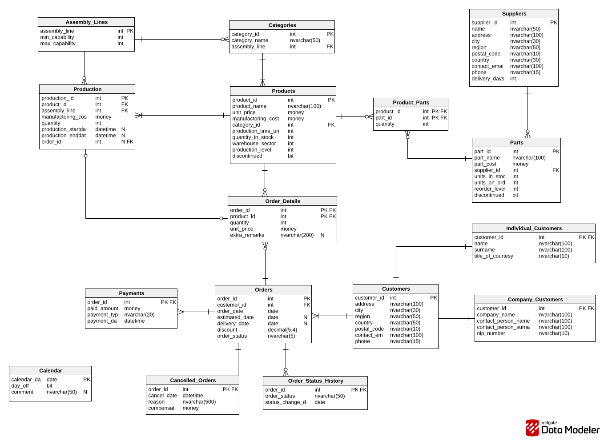

## Dokumentacja projektu "firma produkcyjno-usługowa"

Dzień i godzina zajęć: pt. 9:45

Nr zespołu: 18

**Autorzy:** Małgorzata Liskowska, Stanisław Ogonowski, Bartłomiej Wiśniewski

## 1. Wymagania funkcyjne systemu

Celem projektu jest projekt bazy danych dla firmy usługowo-produkcyjnej.
Klient biznesowy specjalizuje się w produkcji mebli biurowych, w szczególności do pomieszczeń z urządzeniami komputerowymi.

### Persona: klient sklepu

- klient składa zamówienie, znając oczekiwaną datę odbioru. Oczekiwana data reliazacji zamówienia jest obliczona automatycznie na podstawie aktualnych zamówień, stanu magazynu i dostępności części.
- w przypadku braku części potrzebnych do realizacji zamówienia, do oczekiwanej daty zamówienia dodawany jest także czas potrzebny na sprowadzenie części.
- klient może modyfikować swoje zamówienie, jednak może to powodować opóźnienie w planie produkcji.
- w przypadku rezygnacji z zamówienia klient może ponieść dodatkową opłatę.
- klient jest informowany w przypadku, gdy zamówienie jest opóźnione i może zrezygnować ze swojego zamówienia; wówczas nie ponosi dodatkowej opłaty za zamówienie.
- klient może zadeklarować metodę płatności jako karta/gotówka lub płatność przy odbiorze, a także regulować płatność na różne sposoby (np. zaliczka, lub w wielu ratach).
- klient może otrzymać rabat procentowy na całe zamówienie.
- klientem może być zarówno klient indywidualny jak i zewnętrzna firma.
- klient może przeglądać produkty po kategoriach.

### Założenia

- konkretna część jest dostarczana przez jednego dostawcę.
- koszt pracy linii produkcyjnych jest niezależny od liczby produktów.
- umowy z dostawcami są podpisywane z góry na cały rok.
- sklep nie odpowiada za wysyłkę towarów.
- produkty są składane na poszczególnych zespołach linii produkcyjnych, w zależności od kategorii, do której należą. Na danym zespole linii produkcyjnych mogą być produkowane produkty z wielu kategorii.
- zawarta jest informacja o maksymalnych mocach przerobowych firmy na konkretnym zestawie linii produkcyjnych.
- na każdym zestawie linii produkcyjnych istnieje minimalny poziom produkcji.
- sklep domawia części na magazyn, jeśli na magazynie jest mniej niż 10% docelowej wartości.
- w przypadku braku części na zamówienie sklep domawia je w taki sposób, aby wciąż osiągać określony cel.
- na podstawie aktualnych zamówień ustalana jest kolejka, na podstawie której produkowane są poszczególne produkty.
- w przypadku braku zamówień sklep dąży do określonego poziomu danego produktu na magazynie.
- klient może modyfikować swoje zamówienie:
  - w przypadku zmniejszenia wielkości zamówienia, wyprodukowana nadwyżka trafia na magazyn (Jeśli produkcja nie została rozpoczęta, jej plan jest odpowiednio modyfikowany).
  - w przypadku zwiększenia wielkości zamówienia:
    - Jeśli aktualna produkcja zwiększa się przed/w trakcie zamówienia, modyfikuje się plan produkcji dla danego produktu.
    - Jeśli aktualna produkcja zwiększa się po wyprodukowaniu zamówienia, tworzy się nowy plan produkcji dla dodatkowo zamówionej partii produktu.

## 2. Baza danych

## Schemat bazy danych



## Opisy poszczególnych tabel (wraz z kodem DDL)

### Products

| Kolumna              | Typ           | Klucz  | Opis/Uwagi                                                                                                                                                   |
| -------------------- | ------------- | ------ | ------------------------------------------------------------------------------------------------------------------------------------------------------------ |
| product_id           | int           | główny | Identyfikator produktu                                                                                                                                       |
| product_name         | nvarchar(100) |        | Nazwa produktu                                                                                                                                               |
| unit_price           | money         |        | Aktualna cena jednostkowa produktu                                                                                                                           |
| manufacturing_cost   | money         |        | Koszt wyprodukowania jednej sztuki (koszt części + robocizna)                                                                                                |
| category_id          | int           | obcy   | Identyfikator kategorii                                                                                                                                      |
| production_time_unit | int           |        | Jednostka określająca całkowitą liczbę jednostek czasu, w której produkowany jest dany produkt. 10 jednostek to jedna roboczogodzina na taśmie produkcyjnej. |
| quantity_in_stock    | int           |        | Liczba sztuk na magazynie                                                                                                                                    |
| warehouse_sector     | int           |        | Sektor w magazynie, przy którym znajduje się produkt                                                                                                         |
| production_level     | int           |        | Liczba sztuk produktu do której dąży się w przypadku mniejszych obrotów na produkcji                                                                         |
| discontinued         | bit           |        | Określa, czy część została wycofana                                                                                                                          |

#### Kod DDL

```sql
-- Table: Products
CREATE TABLE dbo.Products (
    product_id INT IDENTITY(1,1) PRIMARY KEY,
    product_name NVARCHAR(100) NOT NULL,
    manufacturing_cost MONEY NOT NULL ,
    unit_price MONEY NOT NULL CHECK (unit_price >= 0),
    category_id INT NOT NULL,
    production_time_unit INT NOT NULL CHECK (production_time_unit >=0),
    quantity_in_stock INT NOT NULL CHECK (quantity_in_stock >=0),
    warehouse_sector INT NOT NULL CHECK (warehouse_sector >= 0),
    production_level INT NOT NULL CHECK (production_level >= 0),
    discontinued BIT NOT NULL DEFAULT 0
);
```

### ProductParts

| Kolumna    | Typ | Klucz        | Opis/Uwagi                                                                                           |
| ---------- | --- | ------------ | ---------------------------------------------------------------------------------------------------- |
| product_id | int | główny, obcy | Identyfikator produktu                                                                               |
| part_id    | int | główny, obcy | Identyfikator części potrzebnej do produkcji produktu o identyfikatorze product_id                   |
| quantity   | int |              | Liczba części o identyfikatorze part_id potrzebna do produkcji produktu o identyfikatorze product_id |

#### Kod DDL

```sql
-- Table: Product_Parts
CREATE TABLE dbo.Product_Parts (
    product_id INT FOREIGN KEY REFERENCES Products(product_id),
    part_id INT NOT NULL FOREIGN KEY REFERENCES Parts(part_id),
    quantity INT NOT NULL CHECK (quantity >= 0),
    PRIMARY KEY (product_id, part_id)
);
```

### Parts

| Kolumna        | Typ           | Klucz  | Opis/Uwagi                                              |
| -------------- | ------------- | ------ | ------------------------------------------------------- |
| part_id        | int           | główny | Identyfikator części                                    |
| part_name      | nvarchar(100) |        | Nazwa części                                            |
| part_cost      | money         |        | Cena jednostkowa części                                 |
| supplier_id    | int           | obcy   | Identyfikator dostawcy                                  |
| units_in_stock | int           |        | Liczba części w magazynie                               |
| units_on_order | int           |        | Liczba części zamówionych (w drodze)                    |
| reorder_level  | int           |        | Liczba units_in_stock przy której należy domówić części |
| discontinued   | bit           |        | Określa, czy część została wycofana                     |

#### Kod DDL

```sql
-- Table: Parts
CREATE TABLE dbo.Parts (
    part_id INT IDENTITY(1,1) PRIMARY KEY,
    part_name NVARCHAR(100) NOT NULL,
    part_cost MONEY NOT NULL CHECK (part_cost >= 0),
    supplier_id INT INT NULL FOREIGN KEY REFERENCES Suppliers(supplier_id),
    units_in_stock INT NOT NULL CHECK (units_in_stock >= 0),
    units_on_order INT NOT NULL CHECK (units_in_order >= 0),
    reorder_level INT NOT  NULL CHECK (reorder_level >= 0),
    discontinued NOT NULL BIT DEFAULT 0
);
```

### Suppliers

| Kolumna       | Typ           | Klucz  | Opis/Uwagi                                                                  |
| ------------- | ------------- | ------ | --------------------------------------------------------------------------- |
| supplier_id   | int           | główny | Identyfikator dostawcy                                                      |
| name          | nvarchar(50)  |        | Nazwa firmy dostarczającej części                                           |
| address       | nvarchar(100) |        | Ulica i numer budynku                                                       |
| city          | nvarchar(30)  |        | Miasto siedziby firmy                                                       |
| region        | nvarchar(50)  |        | Województwo/stan/land                                                       |
| postal_code   | nvarchar (10) |        | Kod pocztowy                                                                |
| country       | nvarchar(30)  |        | Kraj                                                                        |
| contact_email | nvarchar(100) |        | Adres email                                                                 |
| phone         | nvarchar (15) |        | Numer telefonu                                                              |
| delivery_days | int           |        | Średni oczekiwany czas dostawy (do oszacowania czasu realizacji zamówienia) |

#### Kod DDL

```sql
-- Table: Suppliers
CREATE TABLE dbo.Suppliers (
    supplier_id INT IDENTITY(1,1) PRIMARY KEY,
    name NVARCHAR(100) NOT NULL,
    address NVARCHAR(100) NOT NULL,
    city NVARCHAR(50) NOT NULL,
    region NVARCHAR(50) NOT NULL,
    postal_code NVARCHAR(20) NOT NULL,
    country NVARCHAR(50) NOT NULL,
    contact_email NVARCHAR(100) NOT NULL CHECK (contact_email LIKE '%_@__%.__%'),
    phone NVARCHAR(50) NOT NULL,
    delivery_days INT NOT NULL CHECK (delivery_days >= 0)
);
```

### Categories

| Kolumna       | Typ          | Klucz  | Opis/Uwagi                        |
| ------------- | ------------ | ------ | --------------------------------- |
| category_id   | int          | główny | Identyfikator kategorii           |
| category_name | nvarchar(50) |        | Nazwa kategorii                   |
| assembly_line | int          | obcy   | Numer zespołu linii produkcyjnych |

#### Kod DDL

```sql
-- Table: Categories
CREATE TABLE dbo.Categories (
    category_id INT IDENTITY(1,1) PRIMARY KEY,
    category_name NVARCHAR(100) NOT NULL,
    assembly_line INT NOT NULL FOREIGN KEY REFERENCES Assembly_Lines(assembly_line_id)
);
```

### AssemblyLines

| Kolumna        | Typ | Klucz  | Opis/Uwagi                                                      |
| -------------- | --- | ------ | --------------------------------------------------------------- |
| assembly_line  | int | główny | Numer taśmy produkcyjnej                                        |
| min_capability | int |        | Minimalna liczba produktów wytwarzanych na taśmie w ciągu dnia  |
| max_capability | int |        | Maksymalna liczba produktów wytwarzanych na taśmie w ciągu dnia |

#### Kod DDL

```sql
-- Table: Assembly_Lines
CREATE TABLE dbo.Assembly_Lines (
    assembly_line_id INT IDENTITY(1,1) PRIMARY KEY,
    min_capability INT NOT NULL CHECK (min_capability >= 0),
    max_capability INT NOT NULL,
    CONSTRAINT capabilty CHECK (max_capability >= min_capabilty)
);
```

### Production

| Kolumna              | Typ      | Klucz        | Opis/Uwagi                                                                                              |     |
| -------------------- | -------- | ------------ | ------------------------------------------------------------------------------------------------------- | --- |
| production_id        | int      | główny       | Identyfikator produkcji                                                                                 |
| product_id           | int      | główny, obcy | Identyfikator produktu                                                                                  |
| assembly_line        | int      | główny, obcy | Numer taśmy produkcyjnej                                                                                |     |
| manufacturing_cost   | money    |              | Koszt wyprodukowania jednej sztuki (włącznie z częściami - koszt ten może się zmieniać z biegiem czasu) |
| quantity             | int      |              | Liczba wyprodukowanego produktu w danej partii                                                          |
| production_startdate | datetime |              | Data rozpoczęcia produkcji                                                                              |
| production_enddate   | datetime |              | Data zakończenia produkcji                                                                              |

#### Kod DDL

```sql
-- Table: Production
CREATE TABLE dbo.Production (
    production_id INT IDENTITY(1,1) PRIMARY KEY,
    product_id INT NOT NULL FOREIGN KEY REFERENCES Products(product_id),
    assembly_line INT NOT NULL FOREIGN KEY REFERENCES Assembly_Lines(assembly_line_id),
    manufacturing_cost MONEY NOT NULL CHECK (manufacturing_cost >= 0),
    quantity INT NOT NULL CHECK (quantity >= 0),
    production_startdate DATETIME NULL,
    production_enddate DATETIME NULL,
    order_id INT NULL FOREIGN KEY REFERENCES Orders(order_id)
    CONSTRAINT production_startdate_bef_enddate CHECK (production_startdate <= production_enddate),
);

```

### Orders

| Kolumna        | Typ          | Klucz  | Opis/Uwagi                                 |
| -------------- | ------------ | ------ | ------------------------------------------ |
| order_id       | int          | główny | Identyfikator zamówienia                   |
| customer_id    | int          | obcy   | Identyfikator klienta                      |
| order_date     | date         |        | Data złożenia zamówienia                   |
| estimated_date | date         |        | Zadeklarowana data dostarczenia zamówienia |
| delivery_date  | date         |        | Rzeczywista data dostarczenia zamówienia   |
| discount       | decimal(5,4) |        | Zniżka na całe zamówienie                  |
| order_status   | nvarchar(5)  |        | Aktualny status zamówienia                 |

#### Kod DDL

```sql
-- Table: Orders
CREATE TABLE dbo.Orders (
    order_id INT IDENTITY(1,1) PRIMARY KEY,
    customer_id INT NOT NULL FOREIGN KEY REFERENCES Customers(customer_id),
    order_date DATE NOT NULL,
    estimated_date DATE NOT NULL,
    delivery_date DATE NULL,
    discount DECIMAL(4, 2) NOT NULL CHECK (discount BETWEEN 0 AND 1) DEFAULT 0.00,
    order_status NVARCHAR(50) DEFAULT 'Pending',
    CONSTRAINT required_date_after_order CHECK (estimated_date >= order_date),
    CONSTRAINT delivery_date_after_order CHECK (delivery_date >= order_date),
);
```

### OrderDetails

| Kolumna       | Typ           | Klucz        | Opis/Uwagi               |
| ------------- | ------------- | ------------ | ------------------------ |
| order_id      | int           | główny, obcy | Identyfikator zamówienia |
| product_id    | int           | główny, obcy | Identyfikator produktu   |
| quantity      | int           |              | Liczba zamówionych sztuk |
| unit_price    | money         |              | Cena za sztukę           |
| extra_remarks | nvarchar(200) |              | Uwagi dodatkowe          |

#### Kod DDL

```sql
-- Table: Order_Details
CREATE TABLE dbo.Order_Details (
    order_id INT FOREIGN KEY REFERENCES Orders(order_id),
    product_id INT FOREIGN KEY REFERENCES Products(product_id),
    quantity INT NOT NULL CHECK (quantity >= 0),
    unit_price MONEY NOT NULL CHECK (unit_price >= 0),
    extra_remarks NVARCHAR(200) NULL,
    PRIMARY KEY (order_id, product_id)
);
```

### Payments

| Kolumna      | Typ          | Klucz        | Opis/Uwagi                                             |
| ------------ | ------------ | ------------ | ------------------------------------------------------ |
| order_id     | int          | główny, obcy | Identyfikator zamówienia                               |
| paid_amount  | money        |              | Zapłacona kwota                                        |
| payment_type | nvarchar(20) |              | Typ płatności (np. karta przy odbiorze, BLIK, przelew) |
| payment_date | datetime     |              | Data zaksięgowania przelewu                            |

#### Kod DDL

```sql
-- Table: Payments
CREATE TABLE dbo.Payments (
    payment_id INT IDENTITY(1,1) PRIMARY KEY,
    order_id INT NOT NULL FOREIGN KEY REFERENCES Orders(order_id),
    paid_amount MONEY NOT NULL CHECK (paid_amount >= 0),
    payment_type NVARCHAR(20) NOT NULL,
    payment_date DATE NOT NULL
);
```

### Cancelled_Orders

| Kolumna      | Typ           | Klucz        | Opis/Uwagi                                        |
| ------------ | ------------- | ------------ | ------------------------------------------------- |
| order_id     | int           | główny, obcy | Identyfikator zamówienia                          |
| cancel_date  | datetime      |              | Data anulowania zamówienia                        |
| reason       | nvarchar(500) |              | Powód anulowania zamówienia                       |
| compensation | money         |              | Wartość dodatkowej opłaty za anulowane zamówienie |

#### Kod DDL

```sql
-- Table: Cancelled_Orders
CREATE TABLE dbo.Cancelled_Orders (
    order_id INT PRIMARY KEY FOREIGN KEY REFERENCES Orders(order_id),
    cancellation_date DATETIME NOT NULL,
    reason NVARCHAR(200) NOT NULL,
    compensation MONEY NOT NULL CHECK (compensation >= 0)
);
```

### Order_Status_History

| Kolumna            | Typ         | Klucz  | Opis/Uwagi                     |
| ------------------ | ----------- | ------ | ------------------------------ |
| order_id           | int         | główny | ID zamówienia                  |
| order_status       | nvarchar(5) |        | Skrót statusu zamówienia       |
| status_change_date | date        |        | Data ostatniej zmienay statusu |

#### Kod DDL

```sql
-- Table: Order_Status_History
CREATE TABLE dbo.Order_Status_History
(
    order_id           int         NOT NULL,
    order_status       nvarchar(50) NOT NULL,
    status_change_date date        NOT NULL,
    CONSTRAINT order_id PRIMARY KEY (order_id)
);
```

### Customers

| Kolumna       | Typ            | Klucz  | Opis/Uwagi                                           |
| ------------- | -------------- | ------ | ---------------------------------------------------- |
| customer_id   | int            | główny | Identyfikator klienta                                |
| address       | nvarchar (100) |        | Ulica i numer budynku                                |
| city          | nvarchar(30)   |        | Miasto siedziby klienta/ Miasto zamieszkania klienta |
| region        | nvarchar(50)   |        | Województwo/stan/land                                |
| country       | nvarchar(50)   |        | Kraj                                                 |
| postal_code   | nvarchar(10)   |        | Kod pocztowy                                         |
| contact_email | nvarchar(100)  |        | Email                                                |
| phone         | nvarchar (15)  |        | Numer telefonu                                       |

#### Kod DDL

```sql
-- Table: Customers
CREATE TABLE dbo.Customers (
    customer_id INT IDENTITY(1,1) PRIMARY KEY,
    address NVARCHAR(100) NOT NULL,
    city NVARCHAR(50) NOT NULL,
    region NVARCHAR(50) NOT NULL,
    country NVARCHAR(50) NOT NULL,
    postal_code NVARCHAR(20) NOT NULL,
    contact_email NVARCHAR(100) NOT NULL,
    phone NVARCHAR(50) NOT NULL
);
```

### IndividualCustomers

| Kolumna           | Typ           | Klucz        | Opis/Uwagi            |
| ----------------- | ------------- | ------------ | --------------------- |
| customer_id       | int           | główny, obcy | Identyfikator klienta |
| name              | nvarchar(100) |              | Imię klienta          |
| surname           | nvarchar(100) |              | Nazwisko klienta      |
| title_of_courtesy | nvarchar(10)  |              | Pan/Pani              |

#### Kod DDL

```sql
-- Table: Individual_Customers
CREATE TABLE dbo.Individual_Customers (
    customer_id INT PRIMARY KEY FOREIGN KEY REFERENCES Customers(customer_id),
    name NVARCHAR(50) NOT NULL,
    surname NVARCHAR(50) NOT NULL,
    title_of_courtesy NVARCHAR(20) NOT NULL
);
```

### CompanyCustomers

| Kolumna                | Typ           | Klucz        | Opis/Uwagi                 |
| ---------------------- | ------------- | ------------ | -------------------------- |
| customer_id            | int           | główny, obcy | Identyfikator klienta      |
| company_name           | nvarchar(100) |              | Nazwa firmy                |
| contact_person_name    | nvarchar(100) |              | Imię osoby kontaktowej     |
| contact_person_surname | nvarchar(100) |              | Nazwisko osoby kontaktowej |
| nip_number             | nvarchar (10) |              | Numer NIP firmy            |

#### Kod DDL

```sql
-- Table: Company_Customers
CREATE TABLE dbo.Company_Customers (
    customer_id INT PRIMARY KEY FOREIGN KEY REFERENCES Customers(customer_id),
    company_name NVARCHAR(100) NOT NULL,
    contact_person_name NVARCHAR(50) NOT NULL,
    contact_person_surname NVARCHAR(50) NOT NULL,
    nip_number NVARCHAR(20) NOT NULL
);
```

### Calendar

| Kolumna       | Typ          | Klucz  | Opis/Uwagi                      |
| ------------- | ------------ | ------ | ------------------------------- |
| calendar_date | date         | główny | Data                            |
| day_off       | tinyint      |        | Dzień tygodnia                  |
| comment       | nvarchar(50) |        | Komentarz dot. przyczyny święta |

#### Kod DDL

```sql
-- Table: Calendar
CREATE TABLE dbo.Calendar
(
    calendar_date DATE PRIMARY KEY,
    day_off BIT  NOT NULL,
    comment  NVARCHAR(50) NULL
);
```

## Referencje pomiędzy tabelami

```sql
-- Reference: AssemblyLines_Category (table: Categories)
ALTER TABLE Categories ADD CONSTRAINT AssemblyLines_Category
    FOREIGN KEY (assembly_line)
    REFERENCES Assembly_Lines (assembly_line);

-- Reference: CompanyCustomer_Customers (table: Company_Customers)
ALTER TABLE Company_Customers ADD CONSTRAINT CompanyCustomer_Customers
    FOREIGN KEY (customer_id)
    REFERENCES Customers (customer_id);

-- Reference: Customers_Orders (table: Orders)
ALTER TABLE Orders ADD CONSTRAINT Customers_Orders
    FOREIGN KEY (customer_id)
    REFERENCES Customers (customer_id);

-- Reference: IndividualCustomer_Customers (table: Individual_Customers)
ALTER TABLE Individual_Customers ADD CONSTRAINT IndividualCustomer_Customers
    FOREIGN KEY (customer_id)
    REFERENCES Customers (customer_id);

-- Reference: OrderDetails_Production (table: Production)
ALTER TABLE Production ADD CONSTRAINT OrderDetails_Production
    FOREIGN KEY (order_id,product_id)
    REFERENCES Order_Details (order_id,product_id);

-- Reference: Order_Details_Product (table: Order_Details)
ALTER TABLE Order_Details ADD CONSTRAINT Order_Details_Product
    FOREIGN KEY (product_id)
    REFERENCES Products (product_id);

-- Reference: Order_Order_Details (table: Order_Details)
ALTER TABLE Order_Details ADD CONSTRAINT Order_Order_Details
    FOREIGN KEY (order_id)
    REFERENCES Orders (order_id);

-- Reference: Orders_Cancelled_Orders (table: Cancelled_Orders)
ALTER TABLE Cancelled_Orders ADD CONSTRAINT Orders_Cancelled_Orders
    FOREIGN KEY (order_id)
    REFERENCES Orders (order_id);

-- Reference: Orders_Payment (table: Payments)
ALTER TABLE Payments ADD CONSTRAINT Orders_Payment
    FOREIGN KEY (order_id)
    REFERENCES Orders (order_id);

-- Reference: Part_Supplier (table: Parts)
ALTER TABLE Parts ADD CONSTRAINT Part_Supplier
    FOREIGN KEY (supplier_id)
    REFERENCES Suppliers (supplier_id);

-- Reference: ProductPart_Part (table: Product_Parts)
ALTER TABLE Product_Parts ADD CONSTRAINT ProductPart_Part
    FOREIGN KEY (part_id)
    REFERENCES Parts (part_id);

-- Reference: ProductPart_Product (table: Product_Parts)
ALTER TABLE Product_Parts ADD CONSTRAINT ProductPart_Product
    FOREIGN KEY (product_id)
    REFERENCES Products (product_id);

-- Reference: Product_Category (table: Products)
ALTER TABLE Products ADD CONSTRAINT Product_Category
    FOREIGN KEY (category_id)
    REFERENCES Categories (category_id);

-- Reference: Production_AssemblyLines (table: Production)
ALTER TABLE Production ADD CONSTRAINT Production_AssemblyLines
    FOREIGN KEY (assembly_line)
    REFERENCES Assembly_Lines (assembly_line);

-- Reference: Production_Product (table: Production)
ALTER TABLE Production ADD CONSTRAINT Production_Product
    FOREIGN KEY (product_id)
    REFERENCES Products (product_id);

-- Reference: Order_Status_History_Orders (table: Order_Status_History)
ALTER TABLE Order_Status_History ADD CONSTRAINT Order_Status_History_Orders
    FOREIGN KEY (order_id)
    REFERENCES Orders (order_id);
```

# 3. Widoki, procedury/funkcje, triggery

## Widoki

1. **Parts_Price** - pokazuje łączną cenę wszystkich części potrzebnych do wyprodukowania każdego produktu (`craft_price`).

```sql
CREATE VIEW Parts_Price AS
    SELECT pp.product_id, p.product_name, SUM(pp.quantity * pa.part_cost) AS craft_price FROM Products p
        INNER JOIN Product_Parts pp ON p.product_id = pp.product_id
        INNER JOIN Parts pa ON pa.part_id = pp.part_id
        GROUP BY pp.product_id, p.product_name
```

2. **Product_Profits** - prezentuje jednostkowy zysk produktu, wyrażony kwotowo oraz procentowo na podstawie ceny sprzedaży i kosztu wytworzenia.

```sql
CREATE VIEW Product_Profits AS
    SELECT product_id, product_name, unit_price, manufacturing_cost, (unit_price-manufacturing_cost) AS profit, (manufacturing_cost/unit_price*100) AS percent_profit FROM Products
```

3. **Individual_Client_Orders** - dla każdego klienta indywidualnego pokazuje jego łączną liczbę złożonych zamówień, liczbę zamówień w trakcie realizacji, łączną sumę wydanych pieniędzy w sklepie (po zniżkach), łączną sumę otrzymanych rabatów, liczbę odwołanych zamówień oraz bilans konta, czyli różnicę między przelanymi pieniędzmi na konto naszej firmy, a sumą wartości wszystkich złożonych zamówień (bilans jest ujemny dla klientów z długiem dla firmy).

```sql
CREATE VIEW Individual_Clients_Orders AS
    WITH Customer_Stats AS (
        SELECT o.customer_id,
            COUNT (DISTINCT o.order_id) AS total_orders,
            COUNT (o.order_id) - COUNT (o.delivery_date) AS handled_orders,
            COALESCE (SUM (od.quantity * od.unit_price * (1 - o.discount)), 0) AS total_money_spent,
            COALESCE (SUM (od.quantity * od.unit_price * o.discount), 0) AS total_money_saved,
            COUNT (DISTINCT co.order_id) AS cancelled_orders_counter,
            COALESCE (SUM (od.quantity * od.unit_price * (1 - o.discount)) - SUM (p.paid_amount), 0) AS balance
        FROM Orders o
        LEFT JOIN Order_Details od
            ON o.order_id = od.order_id
        LEFT JOIN Payments p
            ON o.order_id = p.order_id
        LEFT JOIN Cancelled_Orders co
            ON o.order_id = co.order_id
        GROUP BY o.customer_id
    )
    SELECT ic.customer_id, ic.name, ic.surname,
           total_orders, handled_orders,
           total_money_spent, total_money_saved,
           cancelled_orders_counter, balance
    FROM Individual_Customers ic
        LEFT JOIN Customer_Stats cs
            ON ic.customer_id = cs.customer_id;
```

4. **Products_Customers** - widok produktów z perspektywy klienta.

```sql
CREATE VIEW Products_Customers AS
    SELECT product_id,
           product_name,
           category_name,
           unit_price,
           quantity_in_stock
    FROM Products
    INNER JOIN
        dbo.Categories C ON Products.category_id = C.category_id
    WHERE discontinued = 0;
```

## Procedury/funkcje

1. **AddOrder** - dodaje zamówienie do bazy danych.

```sql
CREATE PROCEDURE dbo.AddOrder(
    @customer_id INT,
    @estimated_date DATE = NULL,
    @delivery_date DATE = NULL,
    @discount DECIMAL(5, 4) = 0,
    @order_status NVARCHAR(50) = 'Processing'
) AS
BEGIN
    SET NOCOUNT ON;
    INSERT INTO Orders (
        customer_id,
        order_date,
        estimated_date,
        delivery_date,
        discount,
        order_status
    )
    VALUES (
        @customer_id,
        SYSDATETIME(),
        @estimated_date,
        @delivery_date,
        @discount,
        @order_status
    );
END;
GO
```

2. **AddOrderDetail** - dodaje produkt do zamówienia.

```sql
CREATE PROCEDURE dbo.AddOrderDetail(
    @order_id INT,
    @product_id INT,
    @quantity INT,
    @unit_price MONEY,
    @extra_remarks NVARCHAR(200) = NULL
) AS
BEGIN
    SET NOCOUNT ON;
    INSERT INTO Order_Details
        (order_id, product_id, quantity, unit_price, extra_remarks)
    VALUES (@order_id,
            @product_id,
            @quantity,
            @unit_price,
            @extra_remarks)
END;
GO
```

3. **CancelOrder** - przenosi zamówienie do Cancelled_Orders.

```sql
CREATE PROCEDURE dbo.CancelOrder(
    @order_id INT,
    @reason NVARCHAR(500) = NULL,
    @compensation MONEY = 0
) AS
BEGIN
    SET NOCOUNT ON;

    INSERT INTO Cancelled_Orders
        (order_id, cancellation_date, reason, compensation)
    VALUES (@order_id, SYSDATETIME(),
            @reason, @compensation)
END;
GO
```

4. **AddPart** - dodaje nową część do bazy danych.

```sql
CREATE PROCEDURE dbo.AddPart(
    @part_name NVARCHAR(100),
    @part_cost MONEY,
    @supplier_id INT,
    @units_in_stock INT,
    @units_on_order INT,
    @reorder_level INT,
    @discontinued BIT = 0
) AS
BEGIN
    SET NOCOUNT ON;

    INSERT INTO Parts
    (part_name, part_cost, supplier_id, units_in_stock,
     units_on_order, reorder_level, discontinued)
    VALUES (@part_name,
            @part_cost,
            @supplier_id,
            @units_in_stock,
            @units_on_order,
            @reorder_level,
            @discontinued)
END;
GO
```

5. **AddPartToProduct** - dodaje część do definicji produktu.

```sql
CREATE PROCEDURE dbo.AddPartToProduct(
    @part_id INT,
    @product_id INT,
    @quantity INT
) AS
BEGIN
    SET NOCOUNT ON;

    INSERT INTO Product_Parts
    VALUES (@product_id,
            @part_id,
            @quantity)
END;
GO
```

6. **ViewScheduledProduction** - wyświetla zaplanowaną produkcję.

```sql
CREATE PROCEDURE ViewScheduledProduction(
    @product_id INT,
    @start_date DATE,
    @end_date DATE = NULL
) AS
BEGIN
    SET NOCOUNT ON;
    IF @end_date IS NULL
        SET @end_date = SYSDATETIME();

    SELECT production_id,
           production.product_id,
           product_name,
           assembly_line,
           production.manufacturing_cost,
           quantity,
           production_startdate,
           production_enddate,
           order_id
    FROM Production
             INNER JOIN Products
                        ON Production.product_id = Products.product_id
    WHERE production.product_id = @product_id
      AND ((production_startdate >= @start_date AND production_startdate <= @end_date)
        OR (production_enddate >= @start_date AND production_enddate <= @end_date))
END;
GO

```

7. **ViewCurrentProduction** - wyświetla produkty w trakcie produkcji na podanej taśmie produkcyjnej.

```sql
CREATE PROCEDURE ViewCurrentProduction
    @assembly_line INT
AS
    SELECT p.production_id, p.product_id, product_name, p.quantity, p.production_startdate, p.order_id
    FROM Production p
          INNER JOIN Products pr
                     ON p.product_id = pr.product_id
    WHERE production_enddate IS NULL
        AND assembly_line = @assembly_line
GO
```

8. **ViewThreatenedOrders** - wyświetla zamówienia w trakcie produkcji na podanej linii produkcyjnej. Przydatna przy wyświetlaniu zagrożonych zamówień w przypadku awarii linii produkcyjnej.

```sql
CREATE PROCEDURE ViewThreatenedOrders(@assembly_line INT)
AS
BEGIN
    SELECT DISTINCT order_id
    FROM Production
    WHERE production_enddate IS NULL
    AND assembly_line = @assembly_line
END
```

9. **AddProduct** - dodaje nowy produkt do bazy danych.

```sql
CREATE PROCEDURE AddProduct (
    @product_name NVARCHAR(100),
    @unit_price MONEY,
    @manufacturing_cost MONEY,
    @category_id INT,
    @production_time_unit INT,
    @quantity_in_stock INT,
    @warehouse_sector INT,
    @production_level INT,
    @discontinued BIT)
AS
BEGIN
    BEGIN TRY
        BEGIN TRANSACTION
        IF EXISTS(SELECT * FROM Products WHERE product_name = @product_name)
            BEGIN
                THROW 52000, N'Product already exists', 1;
            END

        INSERT INTO Products(product_name,
                             unit_price,
                             manufacturing_cost,
                             category_id,
                             production_time_unit,
                             quantity_in_stock,
                             warehouse_sector,
                             production_level,
                             discontinued)
        VALUES(@product_name,
               @unit_price,
               @manufacturing_cost,
               @category_id,
               @production_time_unit,
               @quantity_in_stock,
               @warehouse_sector,
               @production_level,
               @discontinued)

        COMMIT TRANSACTION;
    END TRY
    BEGIN CATCH
        ;THROW;
    END CATCH
END
```

10. **AddIndividualCustomer** - dodaje nowego klienta indywidualnego do bazy danych.

```sql
CREATE PROCEDURE AddIndividualCustomer
    (@address NVARCHAR(100), @city NVARCHAR(30), @region NVARCHAR(50),
     @country NVARCHAR(50), @postal_code NVARCHAR(10), @contact_email NVARCHAR(100),
     @phone nvarchar(15), @name NVARCHAR(100), @surname NVARCHAR(100),
     @title_of_courtesy NVARCHAR(10))
AS
BEGIN
    SET NOCOUNT ON;

    BEGIN TRY
        BEGIN TRANSACTION;
            INSERT INTO Customers(address, city, region, country, postal_code, contact_email, phone)
            VALUES(@address, @city, @region, @country, @postal_code, @contact_email, @phone)

            DECLARE @customer_id INT = SCOPE_IDENTITY();

            INSERT INTO Individual_Customers(customer_id, name, surname, title_of_courtesy)
            VALUES (@customer_id, @name, @surname, @title_of_courtesy)
        COMMIT TRANSACTION;
    END TRY
    BEGIN CATCH
        ;THROW;
    END CATCH
END
```

11. **AddCompanyCustomer** - dodaje nową firmę będącą klientem do bazy danych.

```sql
CREATE PROCEDURE AddCompanyCustomer
    @address NVARCHAR(100), @city NVARCHAR(30), @region NVARCHAR(50),
    @country NVARCHAR(50), @postal_code NVARCHAR(10), @contact_email NVARCHAR(100),
    @phone NVARCHAR(15), @company_name NVARCHAR(100),
    @contact_person_name NVARCHAR(100), @contact_person_surname NVARCHAR(100),
    @nip_number NVARCHAR(10)
AS
BEGIN
    SET NOCOUNT ON;

    BEGIN TRY
        IF EXISTS(SELECT * FROM Company_Customers WHERE company_name = @company_name)
        BEGIN
            DECLARE @msg NVARCHAR(2048) = FORMATMESSAGE('Company with name "%s" already exists.', @company_name);
            THROW 51000, @msg, 1;
        END

        BEGIN TRANSACTION;

            INSERT INTO Customers (address, city, region, country, postal_code, contact_email, phone)
            VALUES (@address, @city, @region, @country, @postal_code, @contact_email, @phone);

            DECLARE @customer_id INT = SCOPE_IDENTITY();

            INSERT INTO Company_Customers (customer_id, company_name, contact_person_name, contact_person_surname, nip_number)
            VALUES (@customer_id, @company_name, @contact_person_name, @contact_person_surname, @nip_number);

        COMMIT TRANSACTION;
    END TRY
    BEGIN CATCH
        ;THROW;
    END CATCH
END
GO
```

12. **LastOrdersFromClient** - generuje poprzednie zamówienia danego klienta, wraz ze zniżkami i wartością zamówienia przed/po zniżce

```sql
CREATE PROCEDURE LastOrdersFromClient
    @customer_id INT,
    @date_from DATE,
    @date_to DATE
AS
BEGIN
    SELECT
        c.customer_id,
        o.order_id,
        o.order_date,
        SUM(od.unit_price * od.quantity) AS total_before_discount,
        SUM(od.unit_price * od.quantity) * o.discount AS discount_value,
        SUM(od.unit_price * od.quantity) * (1 - o.discount) AS total_after_discount,
        o.discount
    FROM Customers c
    INNER JOIN Orders o
        ON c.customer_id = o.customer_id
    INNER JOIN Order_Details od
        ON o.order_id = od.order_id
    WHERE
        c.customer_id = @customerID
        AND o.order_date BETWEEN @dateFrom AND @dateTo
    GROUP BY
        c.customer_id,
        o.order_id,
        o.order_date,
        o.discount
    ORDER BY
        o.order_date DESC;
END;
```

13. **TopProductGroups** - generuje listę najlepiej sprzedawanych produktów (wewnątrz danej kategorii) w tygodniu, miesiącu, roku, w podanym zakresie dat

```sql
CREATE PROCEDURE TopProductGroups
    @date_from DATE,
    @date_to DATE,
    @category_id INT
AS
BEGIN
    SELECT
        p.product_id,
        p.product_name,

        -- wartości
        SUM(od.unit_price * od.quantity) AS total_before_discount,
        SUM(od.unit_price * od.quantity * od.discount) AS total_discount,
        SUM(od.unit_price * od.quantity * (1 - o.discount)) AS total_after_discount,

        -- grupowanie czasowe
        DATEPART(YEAR, o.order_date) AS year_no,
        DATEPART(MONTH, o.order_date) AS month_no,
        DATEPART(WEEK, o.order_date) AS week_no

    FROM Products p
    INNER JOIN Order_Details od ON od.product_id = p.product_id
    INNER JOIN Orders o ON o.order_id = od.order_id

    WHERE
        p.category_id = @categoryID
        AND o.order_date BETWEEN @dateFrom AND @dateTo

    GROUP BY
        ROLLUP (
            p.product_id,
            p.product_name,
            DATEPART(YEAR, o.order_date),
            DATEPART(MONTH, o.order_date),
            DATEPART(WEEK, o.order_date)
        )

    ORDER BY
        total_after_discount DESC;
END;
```

14. **TopProductsValue** - generuje listę najbardziej dochodowych produktów w tygodniu, miesiącu, roku, w podanym zakresie dat.

```sql
CREATE PROCEDURE TopProductsValue
    @date_from DATE,
    @date_to DATE
AS
BEGIN
    SET NOCOUNT ON;
    SET XACT_ABORT ON;
    BEGIN TRY
        IF @date_from > @date_to
            BEGIN
                DECLARE @msg NVARCHAR(2048) = FORMATMESSAGE('Date To is earlier than Date From');
                THROW 56000, @msg, 1;
            END
        SELECT
            p.product_id,
            p.product_name,

            SUM(od.unit_price * od.quantity) AS total_before_discount,
            SUM(od.unit_price * od.quantity * o.discount) AS total_discount,
            SUM(od.unit_price * od.quantity * (1 - o.discount)) AS total_after_discount,

            DATEPART(YEAR, o.order_date) AS year_no,
            DATEPART(MONTH, o.order_date) AS month_no,
            DATEPART(WEEK, o.order_date) AS week_no

        FROM Products p
        INNER JOIN Order_Details od ON od.product_id = p.product_id
        INNER JOIN Orders o ON o.order_id = od.order_id

        WHERE
            o.order_date BETWEEN @date_from AND @date_to

        GROUP BY
            ROLLUP (
                p.product_id,
                p.product_name,
                DATEPART(YEAR, o.order_date),
                DATEPART(MONTH, o.order_date),
                DATEPART(WEEK, o.order_date)
            )

        ORDER BY
            total_after_discount DESC;
    END TRY
    BEGIN CATCH
        ;THROW;
    END CATCH;
END;
```

15. **TopProductsNumber** - generuje listę najlepiej sprzedawanych produktów w tygodniu, miesiącu, roku, w podanym zakresie dat

```sql
CREATE PROCEDURE TopProductsNumber
    @DateFrom DATE,
    @DateTo DATE
AS
BEGIN
    SET NOCOUNT ON;
    BEGIN TRY
        IF NOT EXISTS(SELECT 1 FROM Orders WHERE order_date BETWEEN @DateFrom AND @DateTo)
            BEGIN
                DECLARE @msg NVARCHAR(2048) = FORMATMESSAGE('No products between selected dates');
                THROW 55000, @msg, 1;
            END
        IF @DateFrom > @DateTo
            BEGIN
                DECLARE @msg1 NVARCHAR(2048) = FORMATMESSAGE('Date To is earlier than Date From');
                THROW 56000, @msg1, 1;
            END
        SELECT
            p.product_id,
            p.product_name,

            SUM(od.quantity) AS total_number,

            DATEPART(YEAR, o.order_date) AS year_no,
            DATEPART(MONTH, o.order_date) AS month_no,
            DATEPART(WEEK, o.order_date) AS week_no

        FROM Products p
        INNER JOIN Order_Details od ON od.product_id = p.product_id
        INNER JOIN Orders o ON o.order_id = od.order_id

        WHERE
            o.order_date BETWEEN @DateFrom AND @DateTo

        GROUP BY
            ROLLUP (
                p.product_id,
                p.product_name,
                DATEPART(YEAR, o.order_date),
                DATEPART(MONTH, o.order_date),
                DATEPART(WEEK, o.order_date)
            )

        ORDER BY
            total_number DESC;
    END TRY
    BEGIN CATCH
        ;THROW;
    END CATCH;
END;
GO
```

16. **TopProductsWeek** - generuje listę najlepiej sprzedawanych produktów w zadanym tygodniu

```sql
CREATE PROCEDURE TopProductsWeek
@week_number INT,
@year INT
    AS
    BEGIN
        BEGIN TRY
            SET NOCOUNT ON;
                IF @week_number > 53
                    BEGIN
                        DECLARE @msg1 NVARCHAR(2048) = FORMATMESSAGE('Week number does not exist');
                        THROW 56000, @msg1, 1;
                    END
            SELECT p.product_id, p.product_name, SUM(od.unit_price * od.quantity) AS val FROM Products p
            INNER JOIN Order_Details od ON od.product_id = p.product_id
            INNER JOIN Orders o ON o.order_id = od.order_id
            WHERE DATEPART(ISO_WEEK, o.order_date) = @week_number
            AND YEAR(o.order_date) = @year
            GROUP BY p.product_id, p.product_name
            ORDER BY val DESC
        END TRY
        BEGIN CATCH
            ;THROW;
        END CATCH;
    END;
```

17. **TopProductsMonth** - generuje listę najlepiej sprzedawanych produktów w miesiącu

```sql
    CREATE PROCEDURE TopProductsMonth
        @month_number INT,
        @year INT
    AS
    BEGIN
        BEGIN TRY
            SET NOCOUNT ON;
                IF @month_number > 12
                    BEGIN
                        DECLARE @msg1 NVARCHAR(2048) = FORMATMESSAGE('Month number does not exist');
                        THROW 56000, @msg1, 1;
                    END
            SELECT p.product_id, p.product_name, SUM(od.unit_price * od.quantity) AS val FROM Products p
            INNER JOIN Order_Details od ON od.product_id = p.product_id
            INNER JOIN Orders o ON o.order_id = od.order_id
            WHERE MONTH(o.order_date) = @month_number
            AND YEAR(o.order_date) = @year
            GROUP BY p.product_id, p.product_name
            ORDER BY val DESC
        END TRY
        BEGIN CATCH
            ;THROW;
        END CATCH;
    END;
```

18. **TopProductsYear** - generuje listę najlepiej sprzedawanych produktów w roku

```sql
    CREATE PROCEDURE TopProductsYear
    @year INT
    AS
    BEGIN
        BEGIN TRY
            SET NOCOUNT ON;
            SELECT p.product_id, p.product_name, SUM(od.unit_price * od.quantity) AS val FROM Products p
            INNER JOIN Order_Details od ON od.product_id = p.product_id
            INNER JOIN Orders o ON o.order_id = od.order_id
            WHERE YEAR(o.order_date) = @year
            GROUP BY p.product_id, p.product_name
            ORDER BY val DESC
        END TRY
        BEGIN CATCH
            ;THROW;
        END CATCH;
    END;
```

19. **EstimateOrderDate** - dla danego zamówienia estymuje datę jego dostarczenia uwzględniając:

- czy produkty nie zostały już wyprodukowane (nie są na magazynie),
- aktualną produkcję (obciążenie na liniach produkcyjnych, to ile zajmie wyprodukowanie każdego produktu),
- dni wolne.

```sql
CREATE PROCEDURE EstimateOrderDate(@order_id INT)
AS
BEGIN
    SET NOCOUNT ON;

    BEGIN TRY
        IF (EXISTS(SELECT * FROM Orders WHERE order_id = @order_id AND estimated_date IS NOT NULL))
            BEGIN
                DECLARE @msg NVARCHAR(2048)
                    = FORMATMESSAGE('A delivery date has already been estimated for "%i" order.', @order_id);
                THROW 52000, @msg, 1;
            END

        BEGIN TRANSACTION;

        -- Jeśli produkt mógł być wydany bezpośrednio z magazynu, to
        -- zostanie wydany następnego dnia roboczego.
        DECLARE @parts_delay INT = 0;
        DECLARE @days_to_finish_order INT = 1;
        DECLARE @estimated_date DATETIME;

        SELECT @parts_delay = MAX(Suppliers.delivery_days)
        FROM Production
        INNER JOIN Products
            ON Production.product_id = Products.product_id
        INNER JOIN Product_Parts
            ON Products.product_id = Product_Parts.product_id
        INNER JOIN Parts
            ON Product_Parts.part_id = Parts.part_id
        INNER JOIN Suppliers
                 ON Parts.supplier_id = Suppliers.supplier_id
        WHERE production.order_id = @order_id AND
              Parts.units_on_order > 0 AND Parts.units_in_stock = 0;

        WITH line_occupancy AS (
            SELECT Assembly_Lines.assembly_line,
                   max_capability,
                   category_id,
                COALESCE(SUM(quantity * production_time_unit) /
                   CAST(max_capability AS DECIMAL(9,2)), 0)
                 AS line_days_occupation
            FROM Production
            INNER JOIN Products ON Production.product_id = Products.product_id
                AND  production_enddate IS NULL AND order_id <> @order_id
            RIGHT JOIN Assembly_Lines ON
                Production.assembly_line = Assembly_Lines.assembly_line
            GROUP BY Assembly_Lines.assembly_line, max_capability, category_id
        )

        SELECT TOP 1 @days_to_finish_order =
                 CEILING((SUM((quantity * production_time_unit)) / max_capability)
                    + line_occupancy.line_days_occupation)
                    + @parts_delay
        FROM Production
        INNER JOIN Products ON Production.product_id = Products.product_id
        INNER JOIN line_occupancy
            ON line_occupancy.assembly_line = Production.assembly_line
        WHERE production.order_id = @order_id
        GROUP BY line_occupancy.category_id, line_occupancy.line_days_occupation, max_capability
        ORDER BY  CEILING((SUM((quantity * production_time_unit)) / max_capability)
                   + line_occupancy.line_days_occupation) DESC;

        -- CAST(CAST(SYSDATETIME() AS DATE) AS DATETIME) używamy, żeby czas był ustawiony na północ.
        SELECT @estimated_date = calendar_date FROM Calendar
            WHERE calendar_date >= CAST(CAST(SYSDATETIME() AS DATE) AS DATETIME) AND day_off = 0
        ORDER BY calendar_date OFFSET (@days_to_finish_order) ROWS FETCH NEXT 1 ROW ONLY;

        UPDATE Orders SET estimated_date
            = @estimated_date WHERE order_id = @order_id;

        COMMIT TRANSACTION;
    END TRY
    BEGIN CATCH
        ;THROW;
    END CATCH
END
GO
```

20. **ViewOrderItems** - dla każdego zamówienia pokazuje informacje o zamówionych produktach.

```sql
CREATE PROCEDURE ViewOrderItems(@order_id INT) AS
BEGIN
    SET NOCOUNT ON;

    SELECT Orders.order_id,
           Products.product_id,
           product_name,
           Products.unit_price,
           quantity,
           Products.unit_price * quantity AS product_total
    FROM Orders
             INNER JOIN Order_Details
                        ON Orders.order_id = Order_Details.order_id
             INNER JOIN Products ON
        Order_Details.product_id = Products.product_id
    WHERE Orders.order_id = @order_id;
END;
GO
```

21. **ViewOrderSummary** - dla każdego zamówienia podsumowuje jego koszt, zniżkę, i cenę po zniżce.

```sql
CREATE PROCEDURE ViewOrderSummary(@order_id INT) AS
BEGIN
    SELECT Orders.order_id,
           SUM(Products.unit_price * quantity) AS order_total,
           discount,
           SUM(Products.unit_price * quantity) * (1 - discount) AS after_discount
    FROM Orders
             INNER JOIN Order_Details
                        ON Orders.order_id = Order_Details.order_id
             INNER JOIN Products ON
        Order_Details.product_id = Products.product_id
    WHERE Orders.order_id = @order_id
    GROUP BY Orders.order_id, discount;
END;
GO
```

## Triggery

1. **OrderStatusChange** - obsługuje zmiany statusu zamówienia, wraz z postępem jego realizacji.

```sql
CREATE TRIGGER dbo.OrderStatusChange
    ON Orders
    AFTER INSERT, UPDATE
    AS
BEGIN
    SET NOCOUNT ON;

    IF UPDATE(order_status)
        BEGIN
            INSERT INTO Order_Status_History (order_id, order_status, status_change_date)
            SELECT inserted.order_id,
                   inserted.order_status,
                   SYSDATETIME()
            FROM inserted;
        END
END;
```

2. **UpdateProductionAndWarehouseWhenNewOrder** - realizuje automatyczną obsługę stanu magazynu i planu produkcji po złożeniu zamówienia. Po dodaniu pozycji do Order_Details zmniejsza stan magazynu produktu. W przypadku braku wystarczającej liczby produktów na magazynie automatycznie tworzy wpis w tabeli Production dla brakującej ilości oraz ustawia stan magazynowy na zero.

```sql
CREATE TRIGGER UpdateProductionAndWarehouseWhenNewOrder
    ON Order_Details
    AFTER INSERT
    AS
BEGIN
    SET NOCOUNT ON;
    -- Jeżeli liczba zamówionych produktów jest mniejsza od liczby produktów na magzynie
    -- to aktualizujemy tabelę Production
    INSERT INTO Production (product_id, quantity, order_id, assembly_line, manufacturing_cost)
    SELECT
        i.product_id,
        i.quantity - p.quantity_in_stock,
        i.order_id,
        pr.assembly_line,
        p.manufacturing_cost * i.quantity
    FROM Products p
    JOIN INSERTED i ON p.product_id = i.product_id
    JOIN Production pr ON p.product_id = pr.product_id
    WHERE i.quantity > p.quantity_in_stock; -- warunek

    -- Aktualizujemy liczbę produktów na magazynie w Products.
    UPDATE p
    SET p.quantity_in_stock
        = IIF((p.quantity_in_stock - i.quantity) < 0, 0, (p.quantity_in_stock - i.quantity))
    FROM Products p
    JOIN INSERTED i ON p.product_id = i.product_id;
END;
GO
```

3. **UpdatePartsInventory** - aktualizuje liczbę poszczególnych części na podstawie wykonanego zamówienia

```sql
CREATE TRIGGER update_parts_inventory
ON Production
AFTER INSERT
AS
BEGIN
    SET NOCOUNT ON;

    ;WITH used_parts AS (
        SELECT 
            pp.part_id,
            SUM(pp.quantity * i.quantity) AS used
        FROM Product_Parts pp
        INNER JOIN inserted i ON i.product_id = pp.product_id
        GROUP BY pp.part_id
    ),
    calc AS (
        SELECT
            p.part_id,
            p.units_in_stock,
            up.used,

            IIF(p.units_in_stock < up.used, p.units_in_stock, up.used) AS to_deduct,

            IIF(up.used > p.units_in_stock, up.used - p.units_in_stock, 0) AS to_order

        FROM Parts p
        JOIN used_parts up ON p.part_id = up.part_id
    )
    UPDATE p
    SET 
        p.units_in_stock = p.units_in_stock - c.to_deduct,
        p.units_on_order = p.units_on_order + c.to_order
    FROM Parts p
    JOIN calc c ON p.part_id = c.part_id;
END;
```

# 4. Indeksy

```sql
-- Indeksy dodane na klucze obce
CREATE INDEX IX_Orders_CustomerID ON dbo.Orders (customer_id);

CREATE INDEX IX_Products_CategoryID ON dbo.Products(category_id);

CREATE INDEX IX_Categories_AssemblyLine ON dbo.Categories(assembly_line);

CREATE INDEX IX_Parts_SupplierID ON dbo.Parts(supplier_id);

CREATE INDEX IX_Production_ProductID ON dbo.Production(product_id);
CREATE INDEX IX_Production_AssemblyLine ON dbo.Production(assembly_line);
CREATE INDEX IX_Production_OrderID ON dbo.Production(order_id);

-- Indeksy dodane na dane
CREATE INDEX IX_Orders_OrderDate ON dbo.Orders(order_date);
CREATE INDEX IX_Orders_EstimatedDate ON dbo.Orders(estimated_date);
CREATE INDEX IX_Orders_DeliveryDate ON dbo.Orders(delivery_date);


CREATE INDEX IX_Production_ProductionStartDate ON dbo.Production(production_startdate);
CREATE INDEX IX_Production_ProductionEndDate ON dbo.Production(production_enddate);
```

# 5. Uprawnienia

Ponizej przedstawiamy przykładowy schemat rol w bazie danych.
Ze względu na ograniczenia w uprawnieniach na bazie w domenie `db.manage` role
nie zostały przetestowane w praktyce.

**Robotnik**

```sql
CREATE ROLE worker AUTHORIZATION u_ubawisnie;

GRANT EXECUTE ON ViewScheduledProduction TO worker;
GRANT EXECUTE ON ViewCurrentProduction TO worker;
GRANT EXECUTE ON ViewThreatenedOrders TO worker;
GRANT SELECT ON OBJECT::PartsPrice TO worker;
```

**Pracownik**

```sql
CREATE ROLE employee AUTHORIZATION u_liskowsk;

GRANT EXECUTE ON AddOrder TO employee;
GRANT EXECUTE ON AddOrderDetail TO employee;
GRANT EXECUTE ON AddCompanyCustomer TO employee;
GRANT EXECUTE ON AddIndividualCustomer TO employee;
GRANT EXECUTE ON AddPart TO employee;
GRANT EXECUTE ON AddProduct TO employee;
GRANT EXECUTE ON AddPartToProduct TO employee;
GRANT EXECUTE ON EstimateOrderDate TO employee;
```

**Klient**

```sql
CREATE ROLE buyer AUTHORIZATION u_ogonowski;

GRANT SELECT ON OBJECT::Products_Customers TO buyer;
GRANT EXECUTE ON AddIndividualCustomer TO buyer;
GRANT EXECUTE ON AddCompanyCustomer TO buyer;
```

**Administrator**

Posiada dostęp do wszystkich procedur.

# Załącznik

Dane zostały wygenerowane przy pomocy modelu LLM Gemini 3.0 Pro,
ostatecznie stworzyliśmy następujący plik `seed.sql`.

```sql
 -- =============================================
-- 2. GENEROWANIE KALENDARZA
-- =============================================

-- Ensure Monday is day 1, so Saturday=6 and Sunday=7
SET DATEFIRST 1;

DECLARE @StartDate DATE = '2025-01-01';
DECLARE @EndDate   DATE = '2045-12-31';

WITH Dates AS (
    SELECT @StartDate AS DateVal
    UNION ALL
    SELECT DATEADD(DAY, 1, DateVal)
    FROM Dates
    WHERE DateVal < @EndDate
)
INSERT INTO dbo.Calendar (calendar_date, day_off, comment)
SELECT
    DateVal,
    -- Set day_off to 1 if it is Saturday (6) or Sunday (7)
    CASE
        WHEN DATEPART(WEEKDAY, DateVal) IN (6, 7) THEN 1
        ELSE 0
    END AS day_off,
    -- Add the day name to comment if it is a weekend, otherwise NULL
    CASE
        WHEN DATEPART(WEEKDAY, DateVal) IN (6, 7) THEN DATENAME(WEEKDAY, DateVal)
        ELSE NULL
    END AS comment
FROM Dates
OPTION (MAXRECURSION 0);

-- Aktualizacja świąt (skrócona wersja logiczna z Twojego skryptu)
UPDATE dbo.Calendar SET day_off = 1, comment = 'Nowy Rok' WHERE MONTH(calendar_date)=1 AND DAY(calendar_date)=1;
UPDATE dbo.Calendar SET day_off = 1, comment = 'Trzech Króli' WHERE MONTH(calendar_date)=1 AND DAY(calendar_date)=6;
UPDATE dbo.Calendar SET day_off = 1, comment = 'Święto Pracy' WHERE MONTH(calendar_date)=5 AND DAY(calendar_date)=1;
UPDATE dbo.Calendar SET day_off = 1, comment = 'Konstytucji 3 Maja' WHERE MONTH(calendar_date)=5 AND DAY(calendar_date)=3;
UPDATE dbo.Calendar SET day_off = 1, comment = 'Wniebowzięcie Najświętszej Maryi Panny' WHERE MONTH(calendar_date)=8 AND DAY(calendar_date)=15;
UPDATE dbo.Calendar SET day_off = 1, comment = 'Wszystkich Świętych' WHERE MONTH(calendar_date)=11 AND DAY(calendar_date)=1;
UPDATE dbo.Calendar SET day_off = 1, comment = 'Święto Niepodległości 11 listopada' WHERE MONTH(calendar_date)=11 AND DAY(calendar_date)=11;
UPDATE dbo.Calendar SET day_off = 1, comment = 'Wigilia Bożego Narodzenia' WHERE MONTH(calendar_date)=12 AND DAY(calendar_date)=24;
UPDATE dbo.Calendar SET day_off = 1, comment = 'Boże Narodzenie' WHERE MONTH(calendar_date)=12 AND DAY(calendar_date) IN (25,26);

-- Święta ruchome (Wielkanoc - uproszczone wywołanie pętli z oryginalnego skryptu)
-- [Tutaj wklej pętlę Gaussa jeśli potrzebujesz pełnej dokładności, dla czytelności skrócono]
-- ... (Logika Gaussa zachowana z oryginału) ...

-- =============================================
-- 3. ŁADOWANIE DANYCH (INSERTY)
-- =============================================

INSERT INTO Suppliers (name, address, city, region, postal_code, country, contact_email, phone, delivery_days)
VALUES
('Drew-Hurt Wielkopolska', 'ul. Tartaczna 15', 'Oborniki', 'Wielkopolskie', '64-600', 'Polska', 'biuro@drewhurt.pl', '+48 61 296 00', 3),
('Shenzhen TechComponents', 'High-Tech Park, District 4', 'Shenzhen', 'Guangdong', '518000', 'Chiny', 'sales@sz-tech.cn', '+86 755 1234', 45),
('SteelForge GmbH', 'Industriestrasse 44', 'Duisburg', 'NRW', '47051', 'Niemcy', 'orders@steelforge.de', '+49 203 9988', 7),
('Tessuti di Milano', 'Via della Moda 12', 'Mediolan', 'Lombardia', '20121', 'Włochy', 'info@tessuti.it', '+39 02 12345', 10),
('RGB Lighting Solutions', 'Gangnam-gu Teheran-ro', 'Seul', 'Seoul Area', '06236', 'Korea Płd.', 'export@rgblights.kr', '+82 2 555 00', 21),
('Plast-System Sp. j.', 'ul. Chemików 7', 'Tarnów', 'Małopolskie', '33-100', 'Polska', 'zamowienia@plast-sys.pl', '+48 14 688 99', 5),
('Nordic Wood Supply AB', 'Skogsvägen 88', 'Umeå', 'Västerbotten', '90187', 'Szwecja', 'hello@nordicwood.se', '+46 90 11223', 14),
('Fasteners & Fixings Ltd', 'Industrial Estate Unit 5', 'Birmingham', 'West Mids', 'B2 4QA', 'Wlk. Brytania', 'support@fasteners.uk', '+44 121 5556', 8),
('ErgoLift Mechanisms', '100 Innovation Dr', 'Chicago', 'Illinois', '60601', 'USA', 'sales@ergolift.com', '+1 312 555 0', 30),
('Eko-Pak Opakowania', 'ul. Magazynowa 2', 'Pruszków', 'Mazowieckie', '05-800', 'Polska', 'logistyka@ekopak.pl', '+48 22 700 80', 2);

INSERT INTO Assembly_Lines (min_capability, max_capability) VALUES
(30, 150), (10, 60), (1, 15), (2, 10), (50, 300);

INSERT INTO Categories (category_name, assembly_line) VALUES
('Biurka Biurowe Standard', 1), ('Szafy i Kontenery', 1), ('Stoły Jadalniane', 1),
('Fotele Ergonomiczne', 2), ('Fotele Gamingowe', 2), ('Sofy Poczekalniowe', 2),
('Biurka Gamingowe LED', 3), ('Tablice Interaktywne', 3),
('Stoły Konferencyjne', 4),
('Ruchome Stojaki na Projektory', 5);

INSERT INTO Products (product_name, manufacturing_cost, unit_price, category_id, production_time_unit, quantity_in_stock, warehouse_sector, production_level, discontinued)
VALUES
('Biurko Basic 120x60', 150.00, 399.00, 1, 15, 50, 1, 10, 0),
('Biurko Narożne Manager', 320.00, 850.00, 1, 35, 15, 1, 5, 0),
('Biurko Open Space 4-stanowiskowe', 800.00, 2200.00, 1, 60, 5, 2, 2, 0),
('Kontenerek Mobilny 3S', 90.00, 249.00, 2, 20, 100, 1, 20, 0),
('Szafa Aktowa Wysoka', 250.00, 699.00, 2, 40, 20, 2, 5, 0),
('Stół Socjalny Okrągły', 180.00, 450.00, 3, 25, 10, 2, 5, 1), -- Np. ten wycofany
('Fotel Ergo-Office Mesh', 220.00, 599.00, 4, 30, 40, 3, 10, 0),
('Fotel Prezesa Skóra Naturalna', 650.00, 1899.00, 4, 60, 5, 3, 2, 0),
('Krzesło Konferencyjne ISO', 45.00, 129.00, 4, 10, 200, 3, 50, 0),
('Fotel Gamingowy RedDragon', 350.00, 899.00, 5, 45, 30, 3, 10, 0),
('Fotel Gamingowy BluePhantom', 350.00, 899.00, 5, 45, 25, 3, 10, 0),
('Tron Streamera RGB (Fotel)', 550.00, 1499.00, 5, 70, 8, 3, 3, 0),
('Sofa Lobby 2-osobowa', 500.00, 1200.00, 6, 80, 4, 4, 2, 0),
('Biurko CyberDesk Pro (Elektryczne)', 900.00, 2100.00, 7, 50, 10, 5, 5, 0),
('Biurko LED RGB Entry', 400.00, 999.00, 7, 30, 25, 5, 10, 0),
('SmartBoard Edu 65 cali', 1800.00, 4500.00, 8, 120, 5, 6, 2, 0),
('SmartBoard Biznes 85 cali 4K', 3500.00, 9900.00, 8, 160, 2, 6, 1, 0),
('Stół Konferencyjny Dąb 3m', 1200.00, 3500.00, 9, 100, 3, 4, 1, 0),
('Stół Modułowy "V"', 800.00, 2100.00, 9, 80, 4, 4, 2, 0),
('Wózek pod Projektor', 60.00, 189.00, 10, 15, 30, 1, 10, 0),
('Uchwyt PC podblatowy', 15.00, 49.00, 10, 5, 100, 1, 20, 0);

-- ZMODYFIKOWANY INSERT DO PARTS (Dodano discontinued)
INSERT INTO Parts (part_name, part_cost, supplier_id, units_in_stock, units_on_order, reorder_level, discontinued)
VALUES
('Blat Melamina 120x60 (Basic)', 40.00, 1, 100, 50, 20, 0),
('Blat Narożny (Manager)', 120.00, 1, 30, 0, 10, 0),
('Blat Lity Dąb 3m (Konferencyjny)', 800.00, 7, 5, 2, 2, 0),
('Płyta Meblowa Boczna (Szafy)', 30.00, 1, 200, 0, 50, 0),
('Stelaż Metalowy Podstawowy', 60.00, 3, 50, 20, 10, 0),
('Nogi do stołu Konferencyjnego (kpl)', 200.00, 3, 10, 0, 2, 0),
('Śruby Montażowe M6 (Paczka 100szt)', 5.00, 8, 1000, 200, 100, 0),
('Uchwyt Meblowy Chrom', 8.00, 8, 300, 0, 50, 1), -- Wycofany model uchwytu
('Kółka Kauczukowe (kpl 5szt)', 15.00, 6, 200, 50, 30, 0),
('Podstawa "Gwiazda" Nylonowa', 25.00, 6, 100, 20, 20, 0),
('Siłownik Gazowy Klasa 4', 35.00, 9, 80, 40, 15, 0),
('Mechanizm Tilt (Bujanie)', 45.00, 3, 60, 0, 10, 0),
('Podłokietnik Regulowany 3D (szt)', 20.00, 6, 150, 0, 40, 0),
('Formatka Piankowa (Siedzisko)', 15.00, 6, 100, 20, 20, 0),
('Tkanina Mesh Oddychająca (mb)', 20.00, 4, 300, 0, 50, 0),
('Ekoskóra Premium (mb)', 35.00, 4, 200, 50, 40, 0),
('Skóra Naturalna Włoska (m2)', 150.00, 4, 40, 10, 5, 0),
('Zestaw LED RGB + Pilot', 45.00, 5, 80, 20, 20, 0),
('Silnik Elektryczny (Biurka)', 150.00, 2, 40, 20, 10, 0),
('Panel Sterujący (Góra/Dół)', 30.00, 2, 50, 10, 10, 0),
('Matryca Dotykowa 65 cali', 1200.00, 2, 8, 5, 3, 0),
('Matryca 4K 85 cali', 2500.00, 2, 4, 2, 1, 0),
('Komputer OPS (Moduł PC)', 400.00, 2, 15, 5, 5, 0),
('Karton Płaski (Biurka)', 5.00, 10, 500, 100, 50, 0),
('Karton Sześcienny (Fotele)', 6.00, 10, 400, 0, 50, 0),
('Folia Bąbelkowa i Zabezpieczenia', 2.00, 10, 1000, 200, 100, 0);

-- Product_Parts, Customers (Individual/Company) - Bez zmian w INSERT, struktura standardowa
INSERT INTO Product_Parts (product_id, part_id, quantity) VALUES
(1, 1, 1), (1, 5, 1), (1, 7, 1), (1, 24, 1),
(2, 2, 1), (2, 5, 2), (2, 7, 2), (2, 24, 1),
(3, 1, 4), (3, 5, 4), (3, 7, 4), (3, 24, 2),
(4, 4, 3), (4, 9, 1), (4, 8, 3), (4, 25, 1),
(5, 4, 5), (5, 8, 2), (5, 7, 1), (5, 24, 1),
(6, 1, 1), (6, 6, 1), (6, 7, 1),
(7, 9, 1), (7, 10, 1), (7, 11, 1), (7, 12, 1), (7, 14, 1), (7, 15, 2), (7, 13, 2), (7, 25, 1),
(8, 10, 1), (8, 11, 1), (8, 12, 1), (8, 14, 2), (8, 17, 3), (8, 13, 2), (8, 25, 1),
(9, 5, 1), (9, 14, 1), (9, 15, 1), (9, 7, 1),
(10, 9, 1), (10, 10, 1), (10, 11, 1), (10, 12, 1), (10, 14, 2), (10, 16, 3), (10, 13, 2), (10, 25, 1),
(11, 9, 1), (11, 10, 1), (11, 11, 1), (11, 16, 3), (11, 14, 2), (11, 25, 1),
(12, 10, 1), (12, 16, 4), (12, 18, 2), (12, 20, 1), (12, 14, 3), (12, 25, 1),
(13, 4, 2), (13, 14, 4), (13, 16, 5), (13, 6, 1),
(14, 1, 1), (14, 5, 1), (14, 19, 2), (14, 20, 1), (14, 18, 1), (14, 7, 2), (14, 24, 1),
(15, 1, 1), (15, 5, 1), (15, 18, 1), (15, 7, 1), (15, 24, 1),
(16, 21, 1), (16, 23, 1), (16, 26, 5), (16, 24, 1), (16, 7, 1),
(17, 22, 1), (17, 23, 1), (17, 5, 1), (17, 26, 8),
(18, 3, 1), (18, 6, 1), (18, 7, 2), (18, 26, 10),
(19, 4, 4), (19, 6, 2), (19, 7, 2),
(20, 5, 1), (20, 9, 1), (20, 4, 1),
(21, 5, 1), (21, 7, 1);

INSERT INTO Customers (address, city, region, country, postal_code, contact_email, phone)
VALUES
('ul. Mokotowska 51/4', 'Warszawa', 'Mazowieckie', 'Polska', '00-543', 'arch.j.bielski@studio-design.pl', '+48 601 999 888'),
('Friedrichstraße 120', 'Berlin', 'Berlin', 'Niemcy', '10117', 'hans.mueller@web.de', '+49 170 123456'),
('10 Downing Street', 'Londyn', 'Greater London', 'Wlk. Brytania', 'SW1A 2AA', 'james.sterling@consultant.uk', '+44 20 7925 00'),
('Avenue des Champs-Élysées 25', 'Paryż', 'Île-de-France', 'Francja', '75008', 'marie.dubois@art-gallery.fr', '+33 6 12 34 56'),
('Václavské náměstí 1', 'Praga', 'Prague', 'Czechy', '110 00', 'pavel.novak@seznam.cz', '+420 602 111 22'),
('5th Avenue 725', 'Nowy Jork', 'New York', 'USA', '10022', 'michael.ross@law-firm.com', '+1 212 555 123'),
('ul. PiotrÅkowska 89', 'Łódź', 'Łódzkie', 'Polska', '90-423', 'kasia.streamer@twitch.tv', '+48 720 333 444'),
('Via Montenapoleone 8', 'Mediolan', 'Lombardia', 'Włochy', '20121', 'giovanni.rossi@fashion.it', '+39 02 777 888'),
('Kungsgatan 4', 'Sztokholm', 'Stockholm', 'Szwecja', '111 43', 'elias.andersen@nordic.se', '+46 8 555 111'),
('Plac Solny 14', 'Wrocław', 'Dolnośląskie', 'Polska', '50-062', 'dr.krzysztof.mocny@politechnika.pl', '+48 71 320 000'),
('Silicon Allee 1', 'Berlin', 'Berlin', 'Niemcy', '10115', 'procurement@tech-unicorn.de', '+49 30 555 666'),
('ul. Cybernetyki 2', 'Warszawa', 'Mazowieckie', 'Polska', '02-677', 'biuro@cd-projekt-red.pl', '+48 22 555 000'),
('Canary Wharf, Level 30', 'Londyn', 'Greater London', 'Wlk. Brytania', 'E14 5AB', 'orders@global-banking.co.uk', '+44 20 7111 22'),
('La Défense 4', 'Paryż', 'Île-de-France', 'Francja', '92800', 'achat@le-grand-corp.fr', '+33 1 47 77 88'),
('Aleja Grunwaldzka 472', 'Gdańsk', 'Pomorskie', 'Polska', '80-309', 'office@olivia-business.pl', '+48 58 333 221'),
('1 Infinite Loop', 'Cupertino', 'California', 'USA', '95014', 'facilities@tech-giant.com', '+1 408 996 101'),
('Rynek Główny 1', 'Kraków', 'Małopolskie', 'Polska', '30-001', 'rektorat@uj.edu.pl', '+48 12 663 111'),
('Potsdamer Platz 3', 'Berlin', 'Berlin', 'Niemcy', '10785', 'kontakt@esport-berlin.de', '+49 30 999 888'),
('ul. Wiejska 4/6/8', 'Warszawa', 'Mazowieckie', 'Polska', '00-902', 'kancelaria@sejm.gov.pl', '+48 22 694 200'),
('Masarykovo nábřeží 2', 'Praga', 'Prague', 'Czechy', '110 00', 'info@coworking-prague.cz', '+420 222 333 44');

INSERT INTO Individual_Customers (customer_id, name, surname, title_of_courtesy) VALUES
(1, 'Janusz', 'Bielski', 'Arch.'), (2, 'Hans', 'Müller', 'Mr.'), (3, 'James', 'Sterling', 'Sir'), (4, 'Marie', 'Dubois', 'Mme'),
(5, 'Pavel', 'Novák', 'Pan'), (6, 'Michael', 'Ross', 'Mr.'), (7, 'Katarzyna', 'Wójcik', 'Pani'), (8, 'Giovanni', 'Rossi', 'Sig.'),
(9, 'Elias', 'Andersen', 'Mr.'), (10, 'Krzysztof', 'Mocny', 'Dr hab.');

INSERT INTO Company_Customers (customer_id, company_name, contact_person_name, contact_person_surname, nip_number) VALUES
(11, 'TechUnicorn GmbH', 'Klaus', 'Weber', 'DE99887766'), (12, 'CyberZone Gaming Studio', 'Marcin', 'Iwiński', '5250009988'),
(13, 'Royal Bank of London', 'Sarah', 'Ferguson', 'GB12345678'), (14, 'Le Bureau Élégant', 'Jean', 'Renoir', 'FR88776655'),
(15, 'Olivia Business Centre', 'Anna', 'Zarządzalska', '5840001122'), (16, 'Silicon Valley Hub', 'Steve', 'Jobsowski', 'US99887766'),
(17, 'Uniwersytet Jagielloński', 'Prof.', 'Dziekan', '6750001234'), (18, 'E-Sport Berlin Arena', 'Torsten', 'Schmidt', 'DE55443322'),
(19, 'Kancelaria Sejmu RP', 'Marek', 'Urzędnik', '5210002580'), (20, 'Prague Co-Work Space', 'Jana', 'Novotna', 'CZ11223344');

-- INSERT ORDERS - order_status domyślnie 'Pending'
INSERT INTO Orders (customer_id, order_date, estimated_date, delivery_date, discount) VALUES
(1, '2025-01-10', '2025-01-15', '2025-01-14', 0.00), (11, '2025-01-12', '2025-01-20', '2025-01-18', 0.05),
(2, '2025-01-15', '2025-01-20', '2025-01-19', 0.00), (3, '2025-01-25', '2025-01-30', '2025-01-29', 0.00),
(14, '2025-02-01', '2025-02-15', '2025-02-14', 0.00), (4, '2025-02-05', '2025-02-10', '2025-02-09', 0.00),
(12, '2025-02-10', '2025-02-28', '2025-02-25', 0.02), (5, '2025-02-14', '2025-02-20', '2025-02-19', 0.05),
(6, '2025-02-20', '2025-02-25', '2025-02-24', 0.00), (15, '2025-02-25', '2025-03-05', '2025-03-04', 0.00),
(7, '2025-03-01', '2025-03-06', '2025-03-05', 0.00), (19, '2025-03-05', '2025-03-20', '2025-03-18', 0.00),
(8, '2025-03-10', '2025-03-15', '2025-03-14', 0.00), (13, '2025-03-15', '2025-03-30', '2025-03-29', 0.03),
(9, '2025-03-20', '2025-03-25', '2025-03-24', 0.00), (16, '2025-04-02', '2025-04-20', '2025-04-18', 0.10),
(10, '2025-04-05', '2025-04-10', '2025-04-09', 0.00), (1, '2025-04-10', '2025-04-15', '2025-04-14', 0.00),
(17, '2025-04-15', '2025-05-01', '2025-04-30', 0.05), (11, '2025-04-20', '2025-04-30', '2025-04-29', 0.05),
(20, '2025-04-25', '2025-05-10', '2025-05-08', 0.00), (2, '2025-05-01', '2025-05-06', '2025-05-05', 0.00),
(18, '2025-05-05', '2025-05-25', '2025-05-23', 0.08), (3, '2025-05-10', '2025-05-15', '2025-05-14', 0.00),
(14, '2025-05-15', '2025-06-01', '2025-05-30', 0.02), (4, '2025-05-20', '2025-05-25', '2025-05-24', 0.00),
(12, '2025-05-25', '2025-06-10', '2025-06-09', 0.05), (5, '2025-06-01', '2025-06-06', '2025-06-05', 0.00),
(15, '2025-06-05', '2025-06-20', '2025-06-19', 0.03), (6, '2025-06-10', '2025-06-15', '2025-06-14', 0.00),
(19, '2025-06-15', '2025-07-01', '2025-06-30', 0.00), (7, '2025-06-20', '2025-06-25', '2025-06-24', 0.00),
(13, '2025-06-25', '2025-07-15', '2025-07-14', 0.05), (8, '2025-06-30', '2025-07-05', '2025-07-04', 0.00),
(16, '2025-07-01', '2025-07-20', '2025-07-18', 0.08), (17, '2025-07-15', '2025-08-30', '2025-08-25', 0.15),
(9, '2025-07-20', '2025-07-25', '2025-07-24', 0.00), (11, '2025-08-01', '2025-08-15', '2025-08-14', 0.05),
(1, '2025-08-05', '2025-08-10', '2025-08-09', 0.00), (20, '2025-08-10', '2025-08-25', '2025-08-24', 0.02),
(10, '2025-08-15', '2025-08-20', '2025-08-19', 0.00), (12, '2025-08-20', '2025-09-10', '2025-09-08', 0.05),
(2, '2025-08-25', '2025-08-30', '2025-08-29', 0.00), (18, '2025-09-01', '2025-09-20', '2025-09-18', 0.05),
(3, '2025-09-02', '2025-09-07', '2025-09-06', 0.00), (14, '2025-09-05', '2025-09-25', '2025-09-23', 0.02),
(4, '2025-09-10', '2025-09-15', '2025-09-14', 0.00), (15, '2025-09-15', '2025-09-30', '2025-09-29', 0.03),
(5, '2025-09-20', '2025-09-25', '2025-09-24', 0.00), (19, '2025-09-25', '2025-10-10', '2025-10-09', 0.00),
(6, '2025-09-28', '2025-10-03', '2025-10-02', 0.00), (13, '2025-10-01', '2025-10-20', '2025-10-18', 0.05),
(7, '2025-10-05', '2025-10-10', '2025-10-09', 0.00), (16, '2025-10-10', '2025-10-30', '2025-10-28', 0.10),
(8, '2025-10-15', '2025-10-20', '2025-10-19', 0.00), (9, '2025-10-20', '2025-10-25', '2025-10-24', 0.00),
(11, '2025-11-02', '2025-11-15', '2025-11-14', 0.00), (17, '2025-11-05', '2025-11-20', '2025-11-19', 0.05),
(1, '2025-11-10', '2025-11-15', '2025-11-14', 0.00), (20, '2025-11-15', '2025-11-30', '2025-11-29', 0.02),
(10, '2025-11-20', '2025-11-25', '2025-11-24', 0.00), (12, '2025-11-25', '2025-12-10', '2025-12-09', 0.15),
(2, '2025-11-28', '2025-12-05', '2025-12-04', 0.20), (3, '2025-11-28', '2025-12-05', '2025-12-04', 0.20),
(14, '2025-12-01', '2025-12-15', '2025-12-14', 0.05),
-- Zamówienia w toku/opóźnione
(18, '2025-12-05', '2025-12-24', NULL, 0.08), (4, '2025-12-10', '2025-12-18', NULL, 0.00),
(13, '2025-12-12', '2026-01-15', NULL, 0.00), (15, '2025-12-15', '2025-12-22', NULL, 0.02),
-- Nowe
(16, '2025-12-18', '2026-01-20', NULL, 0.05), (1, '2025-12-18', '2025-12-21', NULL, 0.00),
(11, '2025-12-18', '2026-02-01', NULL, 0.10), (19, '2025-12-18', '2026-01-10', NULL, 0.00);

-- INSERT ORDER DETAILS (Bez zmian)
INSERT INTO Order_Details (order_id, product_id, quantity, unit_price, extra_remarks)
VALUES
(1, 1, 1, 399.00, NULL), (1, 7, 1, 599.00, NULL), (1, 21, 1, 49.00, NULL),
(2, 14, 5, 2100.00, 'Wtyczki EU'), (2, 21, 5, 49.00, NULL),
(3, 10, 1, 899.00, NULL), (4, 13, 1, 1200.00, 'Kolor szary'),
(5, 18, 1, 3500.00, 'Winda towarowa dostępna'),
(6, 9, 20, 129.00, NULL), (6, 20, 2, 189.00, NULL),
(7, 10, 15, 899.00, NULL), (7, 15, 15, 999.00, NULL),
(8, 5, 2, 699.00, NULL), (9, 1, 1, 399.00, NULL), (10, 4, 10, 249.00, NULL),
(11, 7, 5, 599.00, NULL), (12, 8, 2, 1899.00, 'Skóra czarna'),
(13, 2, 1, 850.00, NULL), (14, 19, 4, 2100.00, NULL), (15, 11, 1, 899.00, NULL),
(16, 14, 20, 2100.00, 'CyberDesk Pro'), (16, 7, 20, 599.00, 'Ergo Mesh'),
(16, 4, 20, 249.00, 'Kontenerki'), (16, 5, 5, 699.00, 'Szafy na dokumenty'),
(17, 9, 100, 115.00, 'Rabat edukacyjny'),
(18, 1, 5, 399.00, NULL), (19, 20, 5, 189.00, NULL), (20, 3, 2, 2200.00, NULL),
(21, 10, 2, 899.00, NULL), (22, 12, 5, 1499.00, 'Arena Berlin - VIP Seats'),
(23, 6, 4, 450.00, NULL), (24, 16, 1, 4500.00, NULL),
(25, 4, 10, 249.00, NULL), (26, 11, 10, 899.00, NULL),
(27, 2, 1, 850.00, NULL), (28, 5, 3, 699.00, NULL),
(29, 1, 10, 399.00, NULL), (30, 8, 1, 1899.00, NULL),
(31, 15, 5, 999.00, NULL), (32, 17, 1, 9900.00, 'Montaż w cenie'),
(33, 1, 2, 399.00, NULL), (34, 18, 1, 3500.00, NULL),
(35, 21, 50, 45.00, NULL), (36, 9, 150, 110.00, 'Cena hurtowa'),
(36, 16, 10, 4200.00, 'Dla sal A i B'), (37, 7, 1, 599.00, NULL),
(38, 14, 2, 2100.00, NULL), (39, 2, 1, 850.00, NULL),
(40, 20, 10, 189.00, NULL), (41, 1, 1, 399.00, NULL),
(42, 10, 5, 899.00, NULL), (43, 13, 2, 1200.00, NULL),
(44, 18, 2, 3500.00, 'Dąb naturalny'), (45, 1, 5, 399.00, NULL),
(46, 5, 5, 699.00, NULL), (47, 6, 2, 450.00, NULL),
(48, 4, 20, 249.00, NULL), (49, 8, 2, 1899.00, NULL),
(50, 8, 10, 1899.00, 'Sejm - Sale komisyjne'), (51, 1, 1, 399.00, NULL),
(52, 19, 2, 2100.00, NULL), (53, 2, 1, 850.00, NULL),
(54, 16, 2, 4500.00, NULL), (55, 10, 1, 899.00, NULL),
(56, 1, 1, 399.00, NULL), (57, 14, 5, 2100.00, NULL),
(58, 9, 20, 129.00, NULL), (59, 11, 1, 899.00, NULL),
(60, 21, 20, 49.00, NULL), (61, 7, 2, 599.00, NULL),
(62, 10, 20, 750.00, 'Black Friday Deal'), (63, 11, 1, 750.00, 'Black Friday Deal'),
(64, 12, 1, 1200.00, 'Black Friday Deal'), (65, 5, 2, 699.00, NULL),
(66, 15, 60, 999.00, 'Pilne! Cała arena'), (66, 10, 60, 899.00, 'Logotypy sponsorów'),
(67, 13, 5, 1200.00, 'Sofy do lobby'),
(68, 18, 5, 3500.00, 'Stół Dębowy 3m'), (68, 8, 20, 1899.00, 'Fotele skórzane'),
(69, 5, 15, 699.00, NULL), (70, 21, 100, 49.00, 'Akcesoria dla pracowników'),
(70, 20, 10, 189.00, NULL), (71, 1, 1, 399.00, 'Prezent dla syna'),
(72, 17, 3, 9900.00, 'SmartBoard 85 4K - Sala Zarządu'),
(73, 19, 10, 2100.00, 'Stoły modułowe do sal spotkań');

-- INSERT PRODUCTION (Produkcja historyczna i powiązana z zamówieniami)
INSERT INTO Production (product_id, assembly_line, manufacturing_cost, quantity, production_startdate, production_enddate, order_id)
VALUES
(1, 1, 150.00, 20, '2024-01-10 06:00', '2024-01-12 14:00', NULL),
(4, 1, 90.00, 60, '2024-01-05 06:00', '2024-01-08 22:00', NULL),
(2, 1, 320.00, 10, '2024-01-20 07:00', '2024-01-22 15:00', NULL),
(9, 2, 45.00, 100, '2024-01-02 06:00', '2024-01-05 14:00', NULL),
(7, 2, 220.00, 15, '2024-01-25 08:00', '2024-01-27 16:00', NULL),
(15, 3, 400.00, 50, '2025-12-06 08:00:00', NULL, 66),
(10, 2, 350.00, 45, '2025-12-07 08:00:00', NULL, 66),
(13, 2, 500.00, 4, '2025-12-12 08:00:00', '2025-12-16 16:00:00', 67),
(18, 4, 1200.00, 5, '2025-12-13 07:00:00', NULL, 68),
(8, 2, 650.00, 20, '2025-12-14 07:00:00', NULL, 68),
(5, 1, 250.00, 15, '2025-12-17 06:00:00', NULL, 69);

-- Historyczna produkcja "zabezpieczona" (SafeData generator)
INSERT INTO Production (product_id, assembly_line, manufacturing_cost, quantity, production_startdate, production_enddate, order_id)
SELECT
    od.product_id, c.assembly_line, p.manufacturing_cost, SUM(od.quantity),
    DATEADD(day, -ABS(CHECKSUM(NEWID()) % 200) - 30, GETDATE()),
    DATEADD(day, 2, DATEADD(day, -ABS(CHECKSUM(NEWID()) % 200) - 30, GETDATE())),
    NULL
FROM Order_Details od
JOIN Orders o ON od.order_id = o.order_id
JOIN Products p ON od.product_id = p.product_id
JOIN Categories c ON p.category_id = c.category_id
WHERE o.delivery_date IS NOT NULL
GROUP BY od.product_id, c.assembly_line, p.manufacturing_cost;

-- Cancelled Orders (Scenariusze)
INSERT INTO Cancelled_Orders (order_id, cancellation_date, reason, compensation)
VALUES
(56, '2025-10-20 18:00:00', 'Rezygnacja klienta', 0.00),
(22, '2025-05-20 10:00:00', 'Brak części na produkcji', 0.00),
(67, '2025-12-16 09:00:00', 'Odstąpienie w trakcie produkcji', 1800.00);

-- Aktualizacja Delivery Date dla anulowanych
UPDATE Orders SET delivery_date = NULL WHERE order_id IN (56, 22, 67);

-- Payments
INSERT INTO Payments (order_id, paid_amount, payment_type, payment_date)
SELECT
    o.order_id, CAST(SUM(od.quantity * od.unit_price) * (1.0 - o.discount) AS MONEY),
    CASE WHEN c.company_name IS NOT NULL THEN 'Przelew' ELSE 'Karta' END,
    CASE WHEN c.company_name IS NOT NULL THEN DATEADD(day, 3, o.order_date) ELSE o.order_date END
FROM Orders o
JOIN Order_Details od ON o.order_id = od.order_id
LEFT JOIN Company_Customers c ON o.customer_id = c.customer_id
WHERE o.order_id NOT IN (SELECT order_id FROM Cancelled_Orders) AND o.order_id <> 73
GROUP BY o.order_id, o.order_date, o.discount, c.company_name;

-- =============================================
-- 4. AKTUALIZACJA LOGIKI (Post-Processing)
-- =============================================

-- 4.1. Uzupełnienie statusów zamówień (order_status)
UPDATE Orders
SET order_status = CASE
    WHEN order_id IN (SELECT order_id FROM Cancelled_Orders) THEN 'Cancelled'
    WHEN delivery_date IS NOT NULL AND delivery_date <= GETDATE() THEN 'Completed'
    WHEN delivery_date IS NULL AND order_date < DATEADD(DAY, -30, GETDATE()) THEN 'Overdue'
    ELSE 'Processing'
END;

-- 4.2. Weryfikacja
SELECT TOP 10 * FROM Products; -- Pokaż kolumny discontinued i units_in_stock
SELECT TOP 10 * FROM Orders ORDER BY order_id DESC; -- Pokaż order_status
```