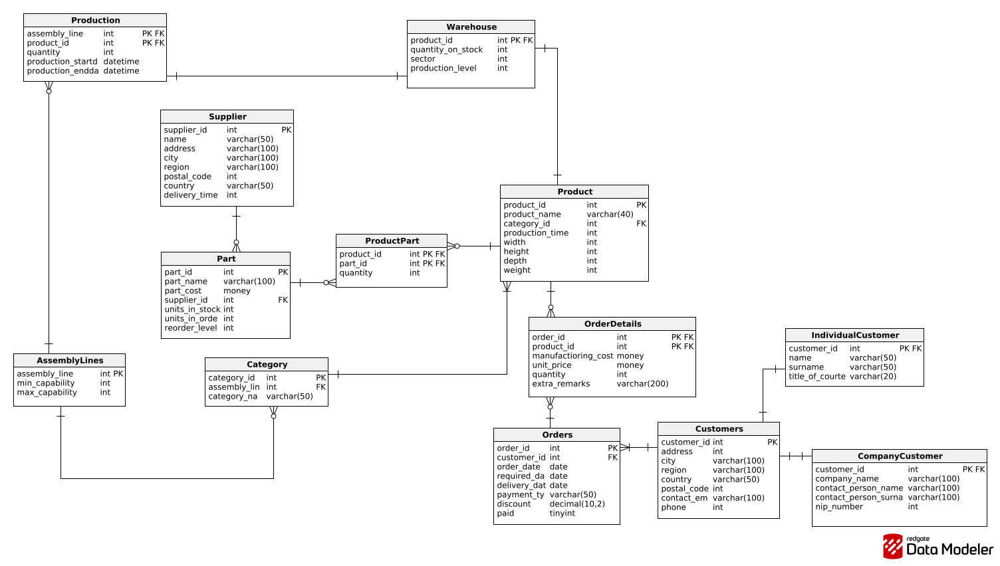

---
## Dokumentacja projektu "firma produkcyjno-usługowa"

Dzień i godzina zajęć: pt. 9:45

Nr zespołu: 18

**Autorzy:** Małgorzata Liskowska, Stanisław Ogonowski, Bartłomiej Wiśniewski

--- 

## 1. Wymagania funkcyjne systemu

Celem projektu jest projekt bazy danych dla firmy usługowo-produkcyjnej. 
Klient biznesowy specjalizuje się w produkcji mebli biurowych, w szczególności do pomieszczeń z urządzeniami komputerowymi.


### Persona: klient sklepu

- klient składa zamówienie, znając oczekiwaną datę odbioru. Oczekiwana data reliazacji zamówienia jest obliczona automatycznie na podstawie aktualnych zamówień, stanu magazynu i dostępności części.
- w przypadku braku części potrzebnych do realizacji zamówienia, do oczekiwanej daty zamówienia dodawany jest także czas potrzebny na sprowadzenie części.
- klient może mieć dodatkowe uwagi do zamówienia, takie jak docięcie mebli na wymiar, co zwiększa koszt robocizny.
- klient jest informowany w przypadku, gdy zamówienie jest opóźnione.
- klient może zadeklarować metodę płatności jako karta/gotówka lub płatność przy odbiorze.
- klient może otrzymać rabat jednostkowy na całe zamówienie.
- klientem może być zarówno klient indywidualny jak i zewnętrzna firma.
- klient może przeglądać produkty po kategoriach.

### Założenia

- konkretna część jest dostarczana przez jednego dostawcę.
- sklep nie odpowiada za wysyłkę towarów.
- produkty są składane na poszczególnych liniach produkcyjnych, w zależności od kategorii, do której należą. Na danej linii produkcyjnej mogą być produkowane produkty z wielu kategorii.
- właściwości produktu, takie jak materiał, czy kolor, są wnioskowane po częściach z jakich produkt jest zrobiony.
- zawarta jest informacja o maksymalnych mocach przerobowych firmy na konkretnej linii produkcyjnej.
- na każdej linii produkcyjnej istnieje minimalny poziom produkcji.
- w przypadku braku zamówień mogą to być produkty najczęściej kupowane.

## 2. Baza danych

## Schemat bazy danych



## Opis poszczególnych tabel

(Dla każdej tabeli  kod DDL wraz z zaimplementowanymi war. integralności, + ewentualnie opis, np. w formie tabelki)


- kod DDL 

```sql
CREATE TABLE Product (
   ProductId int  NOT NULL,
   ProductName varchar(40)  NOT NULL,
   CategoryID int  NOT NULL,
   ProductionTime int  NOT NULL,
   CONSTRAINT ProductId PRIMARY KEY  (ProductId)
);
```

- Opis: (opis tabeli, komentarz)
- np.

| Nazwa atrybutu | Typ | Opis/Uwagi |
| -------------- | --- | ---------- |
| Atrybut 1 …    |     |            |
| Atrybut 2 …    |     |            |

# 3.  Widoki, procedury/funkcje, triggery 


## Widoki

(dla każdego widoku należy wkleić kod polecenia definiującego widok wraz z komentarzem)

```sql
crete or alter view vw_abc 
as
select a from tab1
```


## Procedury/funkcje

(dla każdej procedury/funkcji należy wkleić kod polecenia definiującego procedurę wraz z komentarzem)

```sql
-- ...
```

## Triggery

(dla każdego triggera należy wkleić kod polecenia definiującego trigger wraz z komentarzem)

```sql
-- ...
```


# 4. Inne

(informacja o sposobie wygenerowania danych, uprawnienia …)
